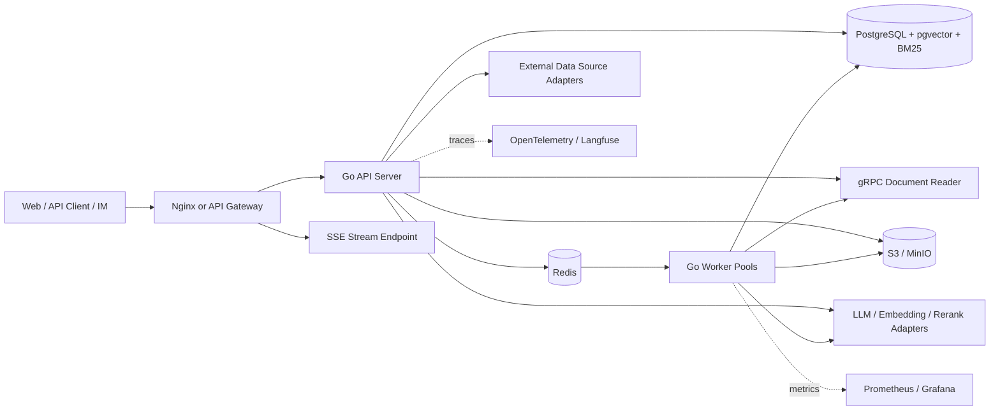
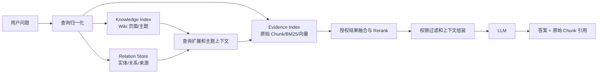
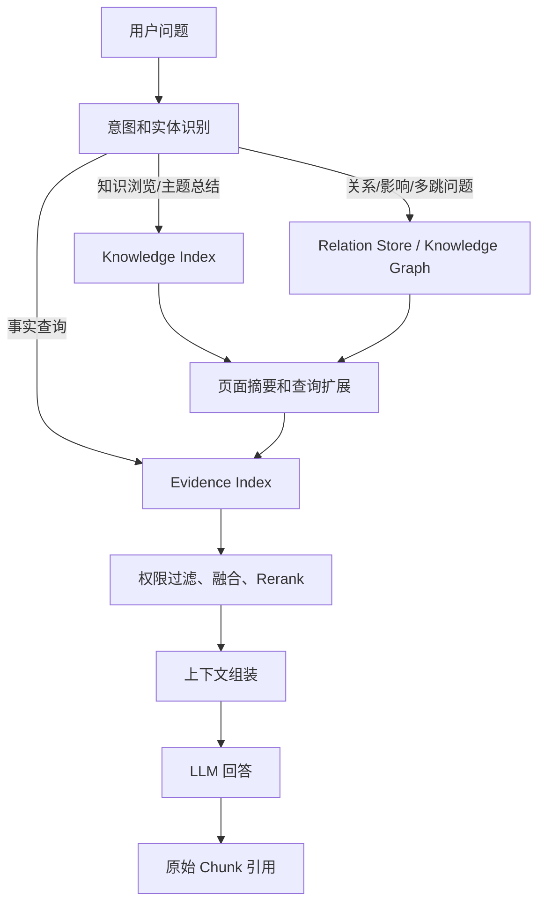
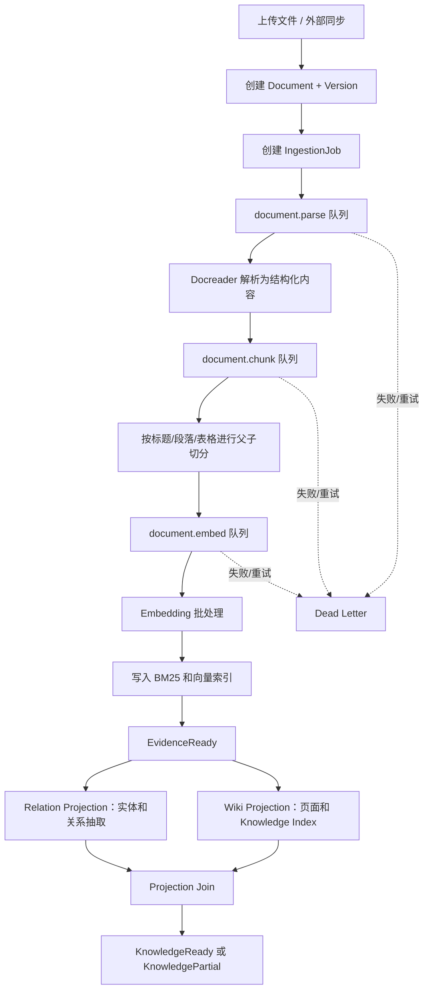
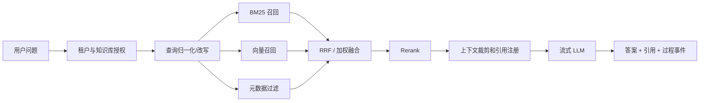
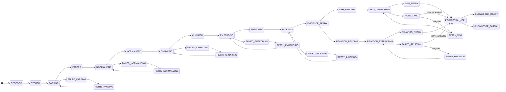
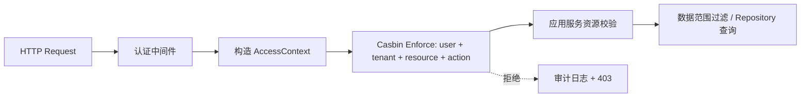

# 企业级知识库平台设计方案

> 基于本地 `/Users/admin/WeKnora` 的架构调研，面向企业内部知识管理、文档问答、知识检索和多租户治理场景。
>
> 当前阶段：架构设计稿。`/Users/admin/rag-platform` 当前以本文件作为设计基线，后续实现应以本文的边界、Schema 和状态机为准。

## 1. 设计目标

平台需要把企业文档、FAQ、网页和外部知识源加工成可治理、可检索、可追溯的知识资产，并支持基于引用的智能问答。

核心目标：

- 支持多租户、多知识库、成员协作、细粒度 RBAC 和审计。
- 总体目标支持 PDF、Word、Excel、PPT、Markdown、HTML、图片等常见格式；MVP 的 PDF 仅限含可提取文本层的数字 PDF，扫描页 OCR 延后。
- 文档入库全异步化，支持解析、切分、向量化、关键词索引和富化任务的状态跟踪、重试、取消和死信。
- 检索采用关键词 + 向量的混合召回，可插拔 Rerank，回答必须能回溯到原文片段。
- 模型、文档解析、向量库、对象存储和外部数据源通过端口与适配器接入。
- 首期采用模块化单体快速交付，文档解析和 Worker 独立部署；后续按真实瓶颈拆分服务。
- 支持 Docker Compose 开发部署和 Kubernetes 企业部署。

非目标：

- 首期不建设面向 Agent 任意代码执行的通用沙箱平台；不可信文档解析的容器隔离基线属于首期安全要求。
- 首期不把所有基础设施抽象成可替换插件；只为确实存在多实现的边界定义端口。

## 2. 对 WeKnora 的借鉴结论

本地 WeKnora 已经验证了以下架构方向：

| 借鉴点 | 采用方式 | 本方案的约束 |
| --- | --- | --- |
| Go 主服务 + Python 文档解析 | 保留 | API、业务编排和异步任务在 Go；解析能力通过 gRPC 独立部署 |
| 知识条目预览接口 + Chunk 列表/详情接口 | 保留并加强 | 保留 Viewer 可预览解析结果与浏览 Chunk 的交互；本方案统一按文档反查知识库并强制 `AuthorizationScope`，不复制按 Chunk ID 直接放行的做法 |
| Handler → Service → Repository | 保留职责分层 | 改成按领域组织，避免全局 Service/Repository 包持续膨胀 |
| 文档处理异步化 | 保留 | 用任务状态机、幂等键、重试和死信保证可运营 |
| BM25 + Dense 混合检索 | 保留 | 首期 PostgreSQL/ParadeDB + pgvector，规模增长后可接 OpenSearch |
| 模型、向量库、对象存储注册表 | 保留 | 注册表只放在基础设施层，领域层不感知供应商 SDK |
| 模型与检索参数配置化 | 保留并强化 | 模型、Embedding、切分、Prompt、检索参数全部外置为配置或模板，代码不内置任何具体模型名、维度或阈值 |
| 知识库工作台与可视化配置 | 保留并重写 | 采用左侧导航、卡片网格、分区设置弹窗和“设置行”表单；组件用 Ant Design 重写，不复制 WeKnora 的 TDesign 主题或源码；只开放数据库级可安全热改的配置 |
| 多租户 RBAC、API Key、审计 | 保留并前置 | 所有应用服务入口都带租户和资源访问上下文 |
| SSE 流式回答与引用 | 保留 | 统一事件协议，支持断线续传和引用回查 |
| 统一 DI 容器 | 部分采用 | 优先显式构造函数注入；组合根集中装配，避免隐藏依赖 |

WeKnora 的代码规模已经覆盖 Agent、Wiki、MCP、沙箱、IM 等大量能力。新平台应先稳定知识库主链路，再将这些能力作为独立模块接入，避免首期形成难以测试和部署的“大而全”系统。

本方案对本地 WeKnora 实现的具体吸收：

- 采用类似 `IndexingStrategy` 的独立能力开关：`vector_enabled`、`keyword_enabled`、`wiki_enabled`、`graph_enabled`，使 Wiki/关系投影可以独立启停，不把所有知识库强制升级为三层能力。
- 采用统一的队列定义和任务路由表，Worker、运行时监控和取消逻辑读取同一份定义；保留 WeKnora 的专用 Worker Pool 和按知识库/文档范围取消任务的运维能力。
- 将 WeKnora 的知识库访问中间件思路上收为统一 `AuthorizationScope`：共享知识库先解析有效租户和资源范围，再进入业务服务与检索器，避免只在接口层做一次权限判断。
- 保留 WeKnora 混合检索按知识库分组、显式传递访问范围的做法；本方案进一步要求 Evidence、Wiki 和 Relation 三类检索器都使用同一个授权端口。
- 保留 Wiki 页面的来源文档和 Chunk 引用关系；本方案把它扩展为 `wiki_page_sources`、`graph_relation_sources` 和不可变 Package，以支持版本、ACL 和投影重建。
- 吸收 WeKnora 的 `config/config.yaml`、`config/builtin_models.yaml` 和 `config/prompt_templates/` 三层配置组织方式，形成本方案第 4.5 节的配置化规范。

## 3. 总体架构

### 3.1 部署拓扑



### 3.2 进程划分

| 进程 | 职责 | 扩缩容方式 |
| --- | --- | --- |
| `api` | REST API、认证、知识库管理、检索接口、聊天入口、SSE | 按请求量水平扩展 |
| `worker` | 文档解析、切分、Embedding、索引、摘要、同步等后台任务 | 按队列独立扩展 |
| `docreader` | 文件解析、OCR、页面图片和结构化内容提取 | 按解析耗时和文件量扩展 |
| `frontend` | React SPA 静态资源和反向代理 | CDN/Nginx 扩展 |
| `scheduler` | 定时同步、清理和补偿任务；可先与 worker 同镜像 | 单实例或分布式锁 |

`api` 和 `worker` 共用领域应用服务与端口定义，但运行入口、资源配额和生命周期独立。这样可以让大批量导入不会挤占在线问答资源。

## 4. 技术栈

### 4.1 推荐选型

| 层次 | 选型 | 用途和原因 |
| --- | --- | --- |
| 前端 | React + TypeScript + Vite | 组件化能力成熟，适合管理台和复杂交互 |
| UI / 状态 | Ant Design + React Router + TanStack Query + Zustand + i18next | 企业后台组件、路由、服务端状态、客户端状态和国际化 |
| 前端表单 / 校验 | React Hook Form + Zod | 表单状态管理和请求参数校验 |
| 前端测试 | Vitest + React Testing Library | 组件、Hooks 和交互行为测试 |
| 后端 | Go 1.26 + Gin | 高并发、部署简单，与参考项目一致 |
| ORM / SQL | GORM + pgx；复杂检索保留原生 SQL | 常规业务开发效率和检索 SQL 可控性兼顾 |
| 依赖注入 | 显式构造函数注入；可选 `uber/dig` | 依赖可见、单测易替换；`dig` 只放在组合根 |
| 主数据库 | PostgreSQL 17 + pgvector + ParadeDB BM25 | 事务、全文检索和向量检索合并，降低首期运维复杂度 |
| 可选检索引擎 | OpenSearch | 文档量、检索吞吐或日志分析达到容量阈值后接入；首期不并行维护多个检索后端 |
| 缓存 / 消息 | Redis 7 + Asynq | 任务队列、限流、分布式锁、事件流和缓存 |
| 对象存储 | S3 兼容存储；开发环境 MinIO | 原始文件、页面图片、导出文件和附件存储 |
| 文档解析 | Python 3.12 + gRPC | 复用 Python 生态，解析服务与 Go 主进程隔离 |
| LLM 接入 | 内部统一协议 + OpenAI Compatible Adapter | 统一 Chat、Embedding、Rerank、VLM 接口，支持多供应商 |
| 模型路由 | Model Registry；规模较大时可接 LiteLLM | 模型配置、密钥、限流、降级和按租户选择 |
| 认证 | OIDC / SSO + JWT；API Key 用哈希存储 | 对接企业身份系统，同时支持程序化访问 |
| 授权 | Go Casbin Domain RBAC + `github.com/casbin/gorm-adapter/v3` | Owner / Admin / Editor / Viewer，加租户和知识库级访问控制 |
| 可观测性 | OpenTelemetry + Prometheus + 结构化日志；Grafana/Loki/Langfuse 按部署档位启用 | 关联请求、任务、模型调用和检索指标 |
| 部署 | Docker Compose + Helm/Kubernetes | 本地开发、私有化和生产集群统一交付方式 |
| API 契约 | OpenAPI 3；gRPC 使用 Protobuf；内部任务使用版本化 Go Schema | 前后端、解析服务和异步任务的稳定边界 |

上表的前端选型是目标形态，不是当前实现现状：`web/` 目前仍是单文件 React + 原生 CSS。M9 按 4.6 节迁移到 React Router + Ant Design + TanStack Query + Zustand + i18next，迁移完成前不得在文档或验收中声称这些组件已经接入。

### 4.2 检索存储策略

首期使用 PostgreSQL/ParadeDB 作为默认检索引擎：

- PostgreSQL 保存业务事实、权限关系、文档元数据和任务状态。
- ParadeDB 提供 BM25 关键词检索。
- pgvector 提供向量检索，使用 HNSW 索引。
- 应用层做过滤、混合召回、RRF 融合和 Rerank。
- 召回侧通过 `KeywordSearcher` / `VectorSearcher` 端口隔离实现（`internal/retrieval/ports.go`）；**索引写入目前仍是 PostgreSQL 专用路径**，不存在独立的写入端口。

当单库规模、写入压力或检索延迟超过容量目标时，按租户或知识库切换到独立检索集群。接入 OpenSearch、Milvus、Qdrant 必须同时改造召回与索引写入两段适配器，不能只替换查询实现；切换不得改变领域层和 API 契约。

### 4.3 双索引 + 关系投影架构

引入 LLM Wiki 和知识图谱后，平台维护两类检索索引和一个关系投影。首期可以共用 PostgreSQL/pgvector 和 BM25，图谱使用 PostgreSQL 关系表；逻辑边界必须保持独立，规模增长后再分别迁移到独立集群。本文中“Knowledge Graph”表示领域能力，“Relation Store”表示图存储：端口定义在 `internal/relationstore`，首期实现为 `internal/platform/relationstore`；端口只覆盖快照与图行存储，种子匹配、BFS、ACL 和证据有效性仍在领域层（见 `docs/adr/0001-relationstore-port.md`）。

每个知识库使用独立的 `IndexingStrategy`，默认配置为 `vector_enabled=true`、`keyword_enabled=true`、`wiki_enabled=false`、`graph_enabled=false`。Wiki 和关系投影只在对应开关开启时创建 Pipeline B 任务；它们共享 Evidence Package，但互不依赖。

| 资产 | 数据内容 | 主要用途 | 权威级别 |
| --- | --- | --- | --- |
| `Evidence Index` | 原始文档版本、父子 Chunk、页码、段落、表格、元数据和向量 | 精确事实检索、权限过滤、最终引用 | 事实源的检索投影 |
| `Knowledge Index` | Wiki 页面、主题摘要、FAQ、页面链接和页面级向量 | 知识导航、主题理解、查询扩展和跨文档组织 | 派生知识视图 |
| `Relation Store` | 实体、属性、关系、关系来源和图谱快照 | 实体定位、多跳查询、影响分析和关联解释 | 派生关系投影 |

三类派生资产的关系：

```text
原始文档 / 文档版本
        |
        +--> Evidence Index: Chunk + BM25 + Embedding
        |
        +--> LLM Wiki: 页面 + 链接 + 来源关系
        |                |
        |                +--> Knowledge Index: Wiki 检索投影
        |
        +--> Relation Store: Entity + Relation + Evidence
```

查询阶段使用按需多路召回：

1. 根据 `QueryPlan` 选择 `Knowledge Index`、`Relation Store` 和 `Evidence Index`。
2. Wiki 页面和图谱关系只提供主题、实体和查询扩展信息。
3. 应用层使用扩展信息定向召回有权限的原始 Chunk。
4. 只有通过权限和来源校验的 Chunk 才能进入 `EvidenceSet`，用于事实验证和最终引用。



权限规则：

- `Evidence Index` 必须在召回查询阶段按 `tenant_id`、知识库、文档和共享范围过滤。
- `Knowledge Index` 的页面权限不能超过其来源文档权限；页面默认继承所有来源文档权限的交集。
- `Relation Store` 的实体、关系和路径查询必须携带来源证据的授权范围；实体存在性本身也按来源权限过滤。
- Wiki 页面和图谱关系被召回后仍要重新校验来源文档和 Chunk 权限，不能只依赖派生对象级权限。
- 最终回答只能引用当前用户有权访问的原始文档版本和 Chunk。

更新规则：

- 原始文档是事实源，两个索引和 Relation Store 均可从文档版本重建。
- 文档新增或修改时，先更新 `Evidence Index`，再异步生成或更新 Wiki 页面和 `Knowledge Index`。
- 文档删除、版本替换或权限变更时，关联 Wiki 页面进入 `stale` / `review_required` 状态，并清理不可见内容的索引和缓存。
- Wiki 页面保存 `source_document_version_ids`、`source_chunk_ids`、`content_hash` 和 `acl_version`，用于溯源、增量更新和权限失效判断。
- 图谱实体和关系保存 `source_chunk_ids`、`graph_snapshot_id` 和 `acl_version`，权限变化时按来源集合重新计算可见性。

推荐的数据表：

```text
evidence_index_records
- chunk_id
- document_version_id
- embedding_model
- vector_dimension
- content_hash
- index_status

knowledge_index_records
- wiki_page_id
- page_version_id
- embedding_model
- content_hash
- source_acl_version
- index_status
```

### 4.4 三层知识架构的职责边界

RAG、LLM Wiki 和知识图谱不是三个互相替代的产品，而是同一份知识资产的三种处理结果：

```text
原始文档 / 文档版本
        |
        +--> Evidence Layer
        |      RAG：保存可检索、可引用的原始证据
        |
        +--> Knowledge Organization Layer
        |      LLM Wiki：生成面向人阅读的页面、目录、摘要和 FAQ
        |
        +--> Knowledge Relation Layer
               Knowledge Graph：生成可计算的实体、属性和关系网络
```

| 能力 | RAG / Evidence Layer | LLM Wiki / Knowledge Organization | 知识图谱 / Knowledge Relation |
| --- | --- | --- | --- |
| 核心问题 | 事实在哪里 | 如何理解和浏览知识 | 事物之间有什么关系 |
| 数据结构 | Chunk、向量、BM25、元数据 | 页面、目录、摘要、FAQ、链接 | Entity、Relation、Property、Evidence |
| 主要消费者 | 检索器、回答生成器 | 用户、Agent、导航和查询改写 | 多跳推理、关联分析、影响分析 |
| 权威程度 | 最终事实证据 | 来源文档的派生解释 | 来源文档的派生关系 |
| 更新方式 | 文档版本变更后优先更新 | 异步重新生成或人工审核 | 增量抽取、实体合并和关系失效 |
| 最终引用 | 原始文档版本和 Chunk | 页面可作为导航，引用仍回到 Chunk | 节点/关系引用来源 Chunk |

#### 三者之间的依赖关系

- RAG 是证据底座，保存原始文本和来源定位信息。
- LLM Wiki 和知识图谱都从同一个 `EvidencePackage` 独立生成；Wiki 页面可以展示关系节点，但不能依赖关系投影才能发布。
- 知识图谱从文档和 Chunk 中抽取实体与关系；Wiki 的主题分类或候选实体只能作为可选提示，不能成为关系抽取的唯一输入，也不能把 Wiki 摘要当作事实来源。
- RAG 查询可以使用 Wiki 页面和图谱关系做查询扩展，最终回答上下文仍必须包含可验证的原始 Chunk。
- 三者通过 `document_version_id`、`chunk_id`、`wiki_page_version_id` 和 `graph_snapshot_id` 建立来源关系，不直接共享彼此的 Repository。

#### 查询编排

查询服务根据问题类型选择不同的执行策略：



推荐的执行规则：

1. **事实查询**：Evidence Index 优先，Wiki 和图谱作为补充。
2. **主题浏览**：Knowledge Index 优先，再用 Evidence Index 验证页面内容。
3. **关系查询**：先从图谱进行实体定位和有限深度遍历，再用 Evidence Index 获取关系证据。
4. **跨文档总结**：Wiki 提供结构，图谱提供关联，RAG 提供原文证据。
5. **时间敏感或合规问题**：跳过过期 Wiki 摘要和未经审核的图谱关系，直接以有效文档版本为准。

#### 数据生命周期和事实优先级

```text
文档创建/更新
  -> 解析和版本化
  -> Evidence Index 更新
  -> Wiki Projection + Relation Projection
  -> Wiki / 关系投影审核或发布
  -> Knowledge Index 和 Relation Snapshot 更新
```

事实优先级固定为：

```text
有效原始文档 Chunk
  > 已审核 Wiki 页面 / 图谱关系
  > 未审核 Wiki 页面 / 图谱关系
```

Wiki 页面和图谱关系都必须记录来源、生成模型、生成时间、文档版本、审核状态和 ACL 版本。来源文档过期、删除或权限变化时，相关 Wiki 页面和图谱关系进入 `stale` 或 `review_required` 状态，并从召回结果中移除。

#### 权限边界

- Evidence Index 在召回阶段执行租户、知识库、文档和 Chunk 权限过滤。
- Wiki 页面的可见范围不能超过来源文档的可见范围。
- 图谱节点、关系和路径查询必须携带来源文档权限条件；禁止通过图谱边间接暴露受限实体关系。
- 用户可以看到 Wiki 页面或图谱关系的前提，是用户有权访问对应的来源 Chunk，除非该内容已经经过明确的脱敏和公开发布流程。
- 三种能力最终都由同一个 `AccessContext` 和授权服务检查，不能分别维护互相矛盾的权限规则。

### 4.5 配置化规范

平台定位是可配置化的知识库平台。领域层不感知任何具体供应商、模型名、向量维度、切分粒度或 Prompt 文案，所有可变量都通过配置或模板注入。这一节定义配置的组织方式、优先级、装载时机和边界，作为第 15 节架构决策第 8 条的规范载体。

#### 4.5.1 配置分类与载体

| 配置类 | 载体 | 示例 | 生效范围 | 装载方式 |
| --- | --- | --- | --- | --- |
| 基础设施连接 | 环境变量 | `DATABASE_URL`、`S3_ENDPOINT`、`REDIS_ADDR`、`DOCREADER_GRPC_ADDR` | 进程级 | 组合根 `config.Load()` 启动时读取 |
| 模型定义 | YAML/JSON 文件 + 环境变量插值 | `EMBEDDING_SOURCE`、`LLM_EMBEDDING_MODEL`、`EMBEDDING_DIMENSION`、`EMBEDDING_BATCH_SIZE`、`RERANK_SOURCE`、`LLM_RERANK_MODEL` | 进程级 | 启动时构造适配器并校验 |
| 切分策略 | YAML 或环境变量 | `CHUNK_SIZE`、`CHUNK_OVERLAP`、`CHUNK_SPLIT_MARKERS`、`PARSER_SANDBOX_ENABLED` | 进程级，可按知识库覆盖 | 切分阶段读取 |
| Prompt 模板 | `config/prompt_templates/*.yaml` | 系统提示、上下文模板、fallback、查询改写、实体/关系抽取、摘要生成 | 进程级，可按租户覆盖 | 启动时加载并校验模板 ID 引用 |
| 检索参数 | YAML + 数据库三级覆盖 | `embedding_top_k`、`vector_threshold`、`keyword_threshold`、`rerank_threshold`、`rerank_top_k`、`rrf_k`、`expansion_score_factor` | 全局默认 → 知识库 → 会话 | 检索请求组装时解析 |
| 索引开关 | 数据库中的 `IndexingStrategy` | `vector_enabled`、`keyword_enabled`、`wiki_enabled`、`graph_enabled` | 知识库级 | 流水线和检索器读取 |

三类载体各有明确边界，不互相替代：

- 环境变量只承载基础设施连接和模型接入凭据，不承载业务语义。
- YAML/JSON 承载模型、切分和检索参数的默认值，随代码发布但可被部署方覆盖。
- 数据库承载需要运行时变更、租户隔离和审计的配置（索引开关、检索参数覆盖、模型绑定），必须记录变更人和变更时间。

#### 4.5.2 Embedding 模型配置化

这是配置化最先落地的一块，也是「不硬编码」最容易被违反的地方。当前实现把 3 维写死在 Go 代码和迁移脚本里，替换真实模型需要改代码、重建索引并全量重新 Embedding。目标状态：

```text
EMBEDDING_SOURCE=local | remote
  local  -> 离线确定性 Adapter，仅用于开发与验收，不具备语义能力
  remote -> OpenAI Compatible /embeddings 端点，适配云厂商和自托管网关

EMBEDDING_BASE_URL      模型端点（remote 必填，缺省回退 LLM_BASE_URL）
EMBEDDING_API_KEY       调用凭据（缺省回退 LLM_API_KEY）
LLM_EMBEDDING_MODEL     模型名（remote 必填）
EMBEDDING_DIMENSION     向量维度，是索引契约的一部分，必须为正整数
EMBEDDING_BATCH_SIZE    单次请求批量大小（部分网关上限更低，如 MaaS 兼容模式 ≤20，超限直接返回 400）
EMBEDDING_TIMEOUT_SECONDS 单次模型调用超时
```

约束：

- Pipeline 只依赖 `Embedder` 接口（`Embed(ctx, texts) ([][]float32, error)`、`Dimension() int` 与 `Name() string`），不感知具体实现。
- 适配器在返回前校验维度与配置一致；不一致直接失败，绝不静默截断或补齐。
- `chunks` 表新增 `embedding_model` 字段。向量只有与同模型、同维度的向量才可比较，因此按模型版本精确筛选需要重建的 Chunk，而不是全表清空。
- `knowledge_bases` 同时记录 `embedding_model` 与 `embedding_dimension`，创建时写入当前部署绑定；知识库已有文档后两者锁定，不能通过更新接口就地更换。升级前创建的知识库由 api/worker 启动时回填，已有绑定不被覆盖。
- 入库的 Embed 阶段与检索的向量通道都校验知识库绑定与当前适配器一致；不一致时入库以 `embedding_binding_mismatch` 终止，检索跳过向量通道但保留关键词召回。
- 向量索引的维度与 `EMBEDDING_DIMENSION` 一致。HNSW 索引无法原地改维度，维度变更需要新迁移重建索引并全量重新 Embedding，过程写在受管的运维流程里受 `IndexingStrategy` 约束。
- `APP_ENV=production` 时禁止 `EMBEDDING_SOURCE=local`，避免哈希向量静默进入生产检索。
- 开发环境未配置时默认落到 `local` 源，保证零依赖启动；生产环境缺失配置必须启动失败。

迁移 `migrations/postgres/0005_embedding_model_config.sql` 只记录模型元数据，不把生产维度硬编码进 SQL；`migrations/postgres/0012_knowledge_base_embedding_binding.sql` 增加知识库级绑定。当前 M2 继续使用 3 维本地验收索引。切换到真实模型时，由受管部署/重建命令按 `EMBEDDING_DIMENSION=N` 创建 `halfvec(N)` HNSW 索引，完成全量重建（同时更新知识库绑定）后再切换检索流量，并人工确认没有遗留旧维度 Chunk。

#### 4.5.3 切分与 Prompt 配置化

切分参数从代码外置。不同文档类型（技术手册、制度文件、FAQ）需要不同粒度，必须可配置：

```text
CHUNK_SIZE           目标块大小
CHUNK_OVERLAP        相邻块重叠长度
CHUNK_SPLIT_MARKERS  优先切分标记（换行、句号等）
CHUNK_MIN_SIZE       小于该长度的块与相邻块合并
```

已实现：`Chunker` 是端口，默认实现 `RuneChunker` 采用「标记优先 + 定长窗口」策略。窗口内存在可用标记时，在最后一个标记处切分并放弃重叠（否则整段重复）；没有标记时回退为带重叠的定长切分。尾部不足 `CHUNK_MIN_SIZE` 的块并入前一块。`CHUNK_OVERLAP` 和 `CHUNK_MIN_SIZE` 允许显式取 0，`CHUNK_SPLIT_MARKERS` 支持 `\n`、`\t` 转义，便于在 `.env` 中表达换行标记。启动时校验 `Size > 0`、`0 <= Overlap < Size`、`0 <= MinSize < Size`，不满足则启动失败。

Prompt 模板在 M3 生成层落地时外置为 `config/prompt_templates/*.yaml`，配置中只保存模板 ID 引用，与 WeKnora 的 `xxx_prompt_id` 方式一致。首批模板：系统提示、上下文模板、fallback、查询改写、实体抽取、关系抽取、图谱抽取、生成摘要、生成知识库描述、生成会话标题。约束：

- Go 代码不出现中文字符串拼接的 Prompt 字面量。
- 模板 ID 引用在启动时校验，缺失或重复的模板 ID 导致启动失败。
- 模板内容变更走配置发布，不重新构建镜像；模板变量占位符与 Schema 契约一起版本化。

#### 4.5.4 检索参数三级覆盖

检索参数（`embedding_top_k`、阈值、Rerank 开关和 `top_k`）采用 WeKnora 的三级覆盖模型：

```text
YAML 全局默认  ->  知识库级覆盖（数据库，运行时可改，审计）  ->  会话级覆盖（可选，请求内）
```

阈值和 `top_k` 必须在服务端做区间校验，参考 WeKnora `internal/handler/tenant.go:1764-1776` 的校验区间（向量阈值 0-1、Rerank 阈值 -10 到 10、`top_k` 0-200）。会话级覆盖只开放给有权限的用户，避免普通用户绕过知识库级检索质量约束。

参数与区间清单（每一级都过同一套校验；`config/config.yaml` 为全局默认）：

| 参数 | 区间 | 作用点与语义 |
| --- | --- | --- |
| `top_k` | 0-200 | 最终交给生成层的证据条数 |
| `embedding_top_k` / `keyword_top_k` | 0-200 | 两个召回通道各自的候选深度 |
| `vector_threshold` | 0-1 | 向量召回的余弦下限 |
| `keyword_threshold` | ≥ 0 | BM25 候选的分数下限；BM25 分数无上界（实测可达数百），不是 0-1 |
| `rerank_enabled` | 布尔 | 是否运行 Rerank；关闭时下列两个 Rerank 参数不产生作用 |
| `rerank_threshold` | -10-10 | Rerank 生效时，丢弃重排分低于该值的候选 |
| `rerank_top_k` | 0-200 | Rerank 生效时保留的候选数；0 表示不截断 |
| `context_token_limit` | > 0 | 拼装上下文的近似 Token 上限 |
| `adjacent_expansion` | ≥ 0 | 每个方向补入的相邻块数；父块始终补齐，不受该值影响 |
| `max_adjacent_chunks` | ≥ 0 | 本次扩展补入的相邻块总数上限；0 表示不补相邻块（父块仍补齐） |
| `rrf_k` | 1-200 | RRF 融合常数，决定融合分的量级（默认 60 时榜首约 `2/(60+1)`） |
| `expansion_score_factor` | 0-1 | 扩展块继承锚点分数的折扣，保证扩展内容不越过把它拉进来的精确命中 |

Rerank 适配器由 `RERANK_SOURCE` 选择（`none` 直通 / `lexical` 离线词面重叠 / `remote` OpenAI 兼容 `/rerank`），默认 `none`：开启 Rerank 必须是显式决定。适配器只写入 `rerank_score` 与通道标记，不改写融合分，`rerank_threshold` 因此对 `lexical`（命中词比例）与 `remote`（供应商相关性分）含义一致。

检索接口返回的 `score` 是 RRF 融合分，不是余弦相似度；真实余弦在 `vectorScore`、BM25 分在 `keywordScore`。

#### 4.5.5 边界与不做的事

- 不引入运行时配置中心（Nacos、Apollo、Consul）作为首期依赖。配置来源是环境变量 + 随镜像发布的 YAML + 数据库，足够覆盖当前阶段；确有热更新需求时再评估。
- 不做模型热切换。Embedding 模型变更必须走「改配置 → 重建索引 → 全量重新 Embedding」的受管流程，不允许运行中混用两个模型的向量。
- 不把所有配置项开放为运行时可改。会影响索引结构和已持久化数据的配置（Embedding 维度、切分粒度）必须走迁移或重建流程，不能当作普通设置项。
- 密钥不入配置文件。模型 API Key 只从环境变量或密钥管理服务读取，YAML 中只允许 `${ENV_VAR}` 形式插值。

### 4.6 前端工作台与可视化配置

M1-M4 的 React 页面用单文件、原生 CSS 和 `view` 状态切换验证了 API、权限和文档链路，但还不是目标形态：没有统一导航和路由，知识库设置、检索参数和索引开关只能直接调用 API，运行人员无法在界面上确认当前生效配置。本节定义整体 UI 重构的目标形态。布局、信息密度和设置交互参考本地 WeKnora；组件库沿用 4.1 的 React + Ant Design，不引入 TDesign/Vue，不复制 WeKnora 源码或主题文件。

#### 4.6.1 目标与原则

1. **工作台而不是功能页堆叠**：固定侧边栏承载一级导航，页面内部用页签和设置弹窗分层，新增能力不无限增加顶级入口。
2. **配置分级可见**：数据库级可热改配置提供表单；环境变量/YAML 配置只读展示；影响索引契约的配置不提供热改入口，只展示当前值和受管变更流程。
3. **状态先于装饰**：文档流水线、投影、队列和配置保存的状态必须可定位；颜色只作辅助，状态同时有文字和图标。
4. **权限即界面**：按钮、页签和设置分区按 capability 显隐或禁用；前端判断只改善体验，服务端仍是授权事实源。
5. **参考不复制**：借鉴 WeKnora 的布局、设置行和交互节奏；主题 token、组件和代码由本项目管理，避免引入第二套 Vue 技术栈。
6. **渐进迁移**：先应用壳和视觉 token，再逐页替换单文件视图；每个阶段保持现有 API 和浏览器流程可用。

#### 4.6.2 信息架构与导航

```text
应用壳（AppShell）
├── 侧边栏（展开 260px / 折叠 48px，可拖拽 220-320px）
│   ├── 品牌与全局搜索（⌘K / Ctrl+K）
│   ├── 知识库
│   ├── 问答（会话列表按知识库分组）
│   ├── 运维（owner/admin 可见）
│   └── 底部：租户/用户、主题、语言
└── 主区域
    ├── 页面头部：面包屑、标题、描述、主操作
    └── 页面内容：列表、详情、设置弹窗
```

| 区域 | 内容 | 关键规则 |
| --- | --- | --- |
| 知识库工作台 | 搜索、排序、卡片网格、新建/编辑入口 | 卡片显示名称、描述、文档数、处理中数量、能力徽标（向量/关键词/Wiki/图谱）、ACL 版本和更新时间；卡片点击进入详情，更多操作放溢出菜单 |
| 知识库详情 | 文档、成员、投影三个页签 | 文档页签是默认页；成员页签只对有 `manage_members` 的用户显示；投影页签只展示已启用的 Wiki/图谱状态 |
| 文档详情 | 处理状态、解析内容、Chunk、版本历史、原始预览 | 处理中显示阶段和进度，不显示空白页；版本历史、替换和回滚沿用 M4 API |
| 问答工作台 | 会话列表、消息流、输入区、引用抽屉 | 流式回答显示连接/生成/完成/中断状态；引用点击回到同一文档版本和 Chunk 权限边界 |
| 运维 | 死信、队列、指标、API Key | 只对有运维能力的角色显示；API Key 明文只展示一次 |
| 设置弹窗 | 应用设置、知识库设置 | 全屏遮罩 + 1080×780 面板 + 左侧分组导航 + 右侧内容 + 吸底操作栏；小屏改为全屏 |

知识库设置弹窗使用固定分区：

| 分区 | 内容 | 可见性 |
| --- | --- | --- |
| 基本信息 | 名称、描述 | 读权限可见，写权限可编辑 |
| 检索与索引 | 索引开关、检索参数、生效值 | 读权限可见，写权限可编辑 |
| 成员 | 成员列表与角色 | `manage_members` 可见 |
| 投影 | Wiki/图谱运行状态、重试、重建入口 | 对应能力启用时显示 |
| 数据源 | M5 连接器与同步运行 | 已有 API 后接入；无 API 的功能不显示空壳 |
| 危险区 | 删除知识库 | `knowledge_base:delete` 可见 |

#### 4.6.3 视觉规范

视觉语言以 WeKnora 的绿色品牌梯度、浅灰工作区、白色卡片和轻边框为参考，落到 Ant Design 主题 token 和 CSS 变量。页面和组件不得写死颜色、圆角或阴影，明暗主题共用同一套变量。

| 类别 | 规则 |
| --- | --- |
| 品牌色 | 主色 `#07C05F`；hover `#08DD6E`；active `#06B04D`；浅底 `#E9F8EC`；focus ring 为主色 20%；禁用 `#8CE0AF` |
| 中性色 | 页面 `#F3F3F3`；侧边栏 `#F9F9F9`；容器 `#FFFFFF`；hover `#F3F3F3`；描边 `#DCDCDC`；主文字 90% 黑、次文字 60%、占位 40%、禁用 26% |
| 功能色 | 成功 `#00A870`；警告 `#ED7B2F`；错误 `#E34D59`；信息使用品牌色或中性色，不新增第五套语义色 |
| 圆角 | 2 / 3 / 6 / 9 / 12 / 999px；卡片 9px，按钮和输入 3-6px，徽标 999px |
| 阴影 | 三级阴影，默认卡片只用 1 级；hover 用边框色变化 + 轻阴影，不做位移动画 |
| 字体 | 系统字体栈（`-apple-system, BlinkMacSystemFont, "Segoe UI", "PingFang SC", "Microsoft YaHei", sans-serif`）；正文 14px，辅助 12px，大正文 16px，页面标题 24-28px；等宽字体用于 ID、配置 JSON 和日志 |
| 间距 | 4 / 8 / 12 / 16 / 24 / 32px；卡片内边距 12-16px，页面内容边距 24px，设置行上下间距 16px |
| 布局 | 侧边栏 260px（折叠 48px）；设置面板 1080×780；卡片网格 `repeat(auto-fill, minmax(260px, 1fr))`，间距 10px，卡片最小高度 132px |
| 动效 | 120ms（hover/focus）/ 200ms（面板）；只动颜色、透明度和阴影；`prefers-reduced-motion` 下关闭非必要动画 |
| 主题 | 明 / 暗 / 跟随系统；Ant Design `ConfigProvider` + CSS 变量单一主题源；切换写入用户偏好，不刷新页面 |
| 响应式 | ≥1280px 展开侧边栏；1024-1279px 允许折叠；768-1023px 默认折叠、设置面板 92vw；<768px 侧边栏改抽屉、卡片单列、设置面板全屏、表格改卡片列表 |
| 可访问性 | 所有操作可键盘到达；focus-visible 2px 品牌色描边；图标按钮有 `aria-label`；正文对比度 ≥4.5:1；状态不只靠颜色区分 |

#### 4.6.4 核心交互

- **设置行**：左侧标签 + 说明（约束、单位、生效方式），右侧控件；一行只放一个配置，长表单按“召回 → 融合 → 扩展 → 重排 → 上下文”分组。
- **继承与覆盖**：每个可覆盖参数显示“继承全局默认 / 已覆盖”徽标和当前生效值；修改后显示差值和影响说明，保存前可“恢复为继承”。
- **保存**：底部吸底操作栏；无变更时保存禁用；保存中禁用重复提交；成功后重新读取配置并刷新页面数据；失败按字段映射错误，无法映射的显示为表单级错误。
- **危险变更**：修改索引开关、关闭 Wiki/图谱、删除知识库必须二次确认，并说明会触发的投影失效/重建和检索影响。确认文案来自配置差异，不使用通用“确定吗”。
- **异步反馈**：上传、投影重建、重试使用 toast + 页面状态；列表轮询只在存在处理中条目时开启，页面隐藏时暂停。
- **空态/错误态**：空列表给出下一步动作（新建知识库、上传文档、发起问答）；401 跳转登录；403 显示无权限说明；网络错误提供重试，不把错误吞成空列表。
- **权限**：无写权限时表单只读并隐藏保存；无成员权限时不渲染成员页签；服务端 403 始终覆盖前端判断。

#### 4.6.5 可视化配置面

界面只开放数据库级、可安全热改的配置。环境变量和 YAML 配置只读展示；影响索引结构或已持久化数据的配置必须走受管流程。前端校验只改善体验，服务端校验和授权是唯一事实源。

| 配置项 | 当前载体 | 界面位置 | 可编辑 | 生效方式 | 约束与风险 |
| --- | --- | --- | --- | --- | --- |
| 知识库名称、描述 | 数据库 | 基本信息 | `knowledge_base:write` | 保存后立即生效 | 名称 1-255 字符；不触发重建 |
| `vector_enabled` / `keyword_enabled` | 数据库 `IndexingStrategy` | 检索与索引 | `knowledge_base:write` | 下一次检索计划生效 | 关闭只停止对应召回通道，不删除已生成索引；重新开启可复用 |
| `wiki_enabled` / `graph_enabled` | 数据库 `IndexingStrategy` | 检索与索引 | `knowledge_base:write` | 下一次入库/重建；关闭时清理派生查询 | 开启触发投影；关闭使派生页面/关系失效；保存前必须确认影响 |
| `required_capabilities` | 数据库 `IndexingStrategy` | 检索与索引（只读派生） | 不单独编辑 | 随开关保存 | 默认仅 `evidence`；`wiki`/`relation`/`graph` 只有在对应投影开关开启时才能保留，关闭的投影由前端剪除、服务端返回 400；开启投影不会自动把该投影加入默认查询要求，避免 Evidence 问答被投影故障阻塞 |
| 检索参数（`top_k`、阈值、Rerank、扩展、RRF 等） | 数据库 `retrieval_config` | 检索与索引 | `knowledge_base:write` | 下一次检索请求生效 | 区间见 4.5.4；当前 PATCH 是合并语义，清除覆盖需要整体替换接口 |
| Embedding 源/模型/维度 | 环境变量 | 系统信息（只读） | 无 | 重建索引 + 重启 | 维度是索引契约；禁止热切换；不展示 API Key |
| 切分大小/重叠/标记 | 环境变量 | 系统信息（只读） | 无 | 重新入库 | 当前只有进程级配置，知识库级切分尚未实现，不提供可编辑表单 |
| Chat / Rerank / Parser 源与模型 | 环境变量 | 系统信息（只读） | 无 | 重启或重新解析 | 只展示非敏感值和解析器版本；密钥、端点和对象存储键不返回 |
| API Key | 数据库哈希 | 运维 | 按现有能力 | 立即生效 | 明文只展示一次；列表只显示前缀和状态 |
| 成员与角色 | 数据库 | 成员 | `manage_members` | 立即生效 | Owner/Admin 可管理；Editor/Viewer 不可见成员写操作 |
| 连接器与同步 | 数据库 | 数据源 | 按 M5 能力 | 下一次同步 | 凭据只写不读；同步运行和错误可查看 |
| 审计记录 | 数据库 | 运维 | 只读 | - | 配置保存写入审计；界面不展示密钥或对象存储键 |

**4.6.5.1 配置分级规则**

- **可热改（数据库）**：知识库名称/描述、索引开关、检索参数、成员、API Key、连接器。保存路径固定为：前端表单 → 服务端区间/组合校验 → 写入 + 审计 → 返回最新配置 → 下一次请求生效。
- **只读（环境变量/YAML）**：Embedding、Chat、Rerank、Parser、切分参数。界面展示“当前值 + 来源 + 变更流程”，不提供输入框。
- **受管（索引契约）**：Embedding 模型与维度、切分粒度。变更必须走“改配置 → 重建索引/重新入库 → 校验 → 切换流量”的运维流程；界面只展示当前维度和“受管配置”标识。
- **危险操作**：关闭 Wiki/图谱、删除知识库、清理派生数据。必须二次确认，并在确认框中列出受影响的投影和检索能力。

**4.6.5.2 配置面 API**

现有 `PATCH /api/v1/knowledge-bases/{id}` 已支持 `retrieval_config` 和 `indexing_strategy`，但它是合并语义，无法把某一项恢复为全局默认。M9 增加两个接口，仍由 `knowledgebase.Service` 校验和审计，不改变领域边界：

```text
GET /api/v1/knowledge-bases/{id}/configuration
    -> KnowledgeBaseConfigurationV1

PUT /api/v1/knowledge-bases/{id}/retrieval-config
    -> 整体替换知识库级检索覆盖；{} 表示清除覆盖、回退全局默认
```

`KnowledgeBaseConfigurationV1` 至少包含：

```json
{
  "schemaVersion": "KnowledgeBaseConfigurationV1",
  "knowledgeBaseId": "kb-...",
  "aclVersion": 3,
  "indexingStrategy": {
    "vector_enabled": true,
    "keyword_enabled": true,
    "wiki_enabled": false,
    "graph_enabled": false,
    "required_capabilities": ["evidence"]
  },
  "retrieval": {
    "globalDefaults": {},
    "knowledgeBaseOverride": {},
    "effective": {},
    "sources": { "top_k": "knowledge_base", "vector_threshold": "global" }
  },
  "readOnly": {
    "embedding": { "source": "remote", "model": "...", "dimension": 1024 },
    "chunking": { "size": 800, "overlap": 120, "splitMarkers": "..." },
    "chat": { "source": "remote", "model": "..." },
    "rerank": { "source": "none", "model": "" },
    "parser": { "version": "docreader-m2-v2", "supportedFormats": ["pdf", "docx", "xlsx", "pptx", "md", "txt", "html"] }
  }
}
```

接口规则：

- 读配置需要 `read`；写配置需要 `write`；响应不包含任何密钥、对象存储键、预签名 URL 或完整模型端点凭据。
- `retrieval_config` 的区间校验复用 `retrieval.ValidateOverride`；`indexing_strategy` 复用 `retrieval.ValidateIndexingStrategy`；前端不得自造第二套范围。
- 保存检索参数或索引开关写入审计，审计记录包含操作者、资源和变更后的配置；保存后返回最新配置，前端重新渲染。
- 索引开关整体替换，不做字段级合并，避免四个开关出现不一致组合；检索参数保留现有 PATCH 合并语义，另提供 PUT 整体替换用于清除覆盖。
- 同一设置弹窗内索引开关和检索参数分别调用 PATCH 与 PUT；保存结果按分区展示，任一失败不得把整体标记为已生效。
- 首期不做并发编辑冲突检测，保存采用最后写入生效；设置弹窗打开时读取 `aclVersion`，保存成功后以服务端返回为准，不把本地快照当作事实。

**4.6.5.3 表单规则**

- 每项显示名称、说明、单位、区间、默认值来源和当前生效值；不在表单里重复实现服务端规则，只做即时提示。
- 数值输入使用受控输入 + 失焦校验；空值表示“继承”，不是 0；清除覆盖只在 4.6.5.2 的 PUT 接口可用后开放。
- `required_capabilities` 不提供自由编辑；界面只保留已启用投影对应的能力并在开关变化时剪除关闭项，保存时随策略一起提交。开启 Wiki/Graph 不自动追加为默认查询要求，能力门槛按查询计划逐项判断；服务端拒绝声明未启用投影的能力。
- 同时关闭 `vector_enabled` 和 `keyword_enabled` 时提示“Evidence 检索将没有召回通道”，要求二次确认；不静默允许用户把自己锁成空检索。
- 保存前生成差异摘要：新增/修改/清除的字段，以及会触发的投影重建或失效。
- 保存按钮在无变更、校验失败或加载中禁用；保存失败保留用户输入，不清空表单。

**4.6.5.4 当前实现边界**

- 知识库级切分参数尚未在后端实现，界面只读展示全局值，不提供无效控件；知识库级 Embedding 绑定已实现（创建时写入、有文档后锁定），但界面暂未展示绑定字段。
- Embedding 维度、模型和切分参数不能热改；已有文档的知识库不能通过设置接口更换绑定，变更必须走受管重建流程。
- 没有配置中心、模型热切换、运行中混用向量模型或自动重建索引的能力。
- 任何“恢复默认”按钮必须在 PUT 接口可用后上线；不得用发送当前全局默认值的方式伪装清除覆盖。

#### 4.6.6 迁移顺序

1. **应用壳与设计 token**：引入 React Router、Ant Design、TanStack Query、Zustand、i18next；建立 AppShell、侧边栏、页面头部、主题和权限门；把现有登录、知识库、文档、问答、API Key、运行巡检视图迁移到路由页面，保持 API 行为不变。
2. **知识库工作台与文档体验**：卡片网格、搜索/排序、知识库详情页签、文档列表轮询、文档详情三区、版本历史入口和空态/错误态。
3. **可视化配置**：新增 `GET configuration` 与 `PUT retrieval-config`；知识库设置弹窗、索引开关、检索参数分组表单、继承/覆盖/生效值、确认框和审计提示。
4. **问答与运维打磨**：会话列表、流式状态、引用抽屉、死信/队列/指标页面、API Key 明文仅展示一次、暗色主题、响应式和小屏适配。
5. **回归与验收**：Vitest + React Testing Library 覆盖配置表单、权限门和状态渲染；浏览器回归现有 M1-M4 流程；运行构建、静态检查和现有验收脚本。

#### 4.6.7 验收标准

- 现有 M1-M4 浏览器流程不回归：登录/登出、知识库创建与删除、成员授权、上传与替换、文档详情、问答与引用、API Key、运行巡检。
- 知识库设置中可修改检索参数和索引开关；非法区间返回 400 并定位到字段；无写权限用户只读；Editor 不能管理成员；保存后刷新仍能看到配置；审计记录可查询。
- 检索参数保存后下一次检索生效；向量/关键词开关关闭后对应通道不再参与召回；Wiki/图谱开关变更触发投影失效/重建，关闭后派生查询不可用。
- `PUT retrieval-config` 发送 `{}` 后知识库覆盖被清除，`sources` 回到全局默认；没有该接口时界面不得显示“恢复默认”。
- 界面不展示 API Key 明文（除一次性创建结果）、模型密钥、对象存储键、预签名 URL 或完整模型端点凭据。
- 明/暗/跟随系统主题可用；1280px、768px、375px 三档布局可用；键盘可完成设置保存、弹窗关闭和主要导航；状态不只靠颜色表达。
- `npm test`、`npm run build`、`tsc`（如启用）、`make lint` 通过；`./scripts/m1_acceptance.sh`、`m2`、`m3`、`m4` 在 API 不变的前提下保持通过。
- 不引入 TDesign/Vue，不复制 WeKnora 源码；不新增 4.1 之外的重大前端框架；不开放切分、模型或 Embedding 维度的热改入口。

## 5. 领域模块划分

每个模块内部保持自己的领域模型、应用用例、端口和适配器。模块之间通过应用接口或领域事件协作，不直接访问对方 Repository。

| 模块 | 主要职责 | 关键聚合 / 用例 |
| --- | --- | --- |
| `identity` | 用户、OIDC 登录、API Key、租户、成员和角色 | `User`、`Tenant`、`Membership`、`ApiKey` |
| `knowledgebase` | 知识库、文件夹、标签、共享和生命周期 | `KnowledgeBase`、`Folder`、`Tag` |
| `document` | 文档、版本、来源、内容状态和元数据 | `Document`、`DocumentVersion` |
| `ingestion` | 上传、解析、切分、Embedding、索引和重处理 | `IngestionJob`、`ProcessingRun` |
| `retrieval` | 查询改写、关键词/向量召回、融合、Rerank和引用 | `SearchQuery`、`SearchResult` |
| `knowledgeprojection` | 基于 Evidence Package 生成 Wiki 页面、Knowledge Index 和 Relation Store | `WikiPageVersion`、`Entity`、`Relation`、`ProjectionRun` |
| `conversation` | 会话、消息、流式事件和回答持久化 | `Session`、`Message`、`StreamEvent` |
| `datasource` | 网盘、Git、知识库平台和网页等外部同步 | `Connector`、`SyncRun` |
| `governance` | 审计、配额、限流、任务监控和系统设置 | `AuditLog`、`Quota`、`RuntimeTask` |
| `integration` | API、Webhook、嵌入式 Widget、IM 和 MCP | `Channel`、`IntegrationCredential` |
| `evaluation` | 数据集、检索评估、回答质量和回归基线 | `EvaluationSet`、`EvaluationRun` |
| `agent` | 后续接入工具编排、MCP、技能和长期记忆 | 独立于基础 RAG 和 Knowledge Projection |

首期建议实现 `identity`、`knowledgebase`、`document`、`ingestion`、`retrieval`、`conversation`、`governance` 七个模块；`knowledgeprojection` 在第二阶段通过稳定端口接入，`agent` 延后到第三阶段。

## 6. 项目结构

```text
rag-platform/
├── config/
│   ├── config.yaml                  # 切分、检索参数等默认值
│   ├── models.yaml                  # Embedding / Chat / Rerank 模型定义
│   └── prompt_templates/            # Prompt 模板，配置只引用模板 ID
├── cmd/
│   ├── api/                         # HTTP API 启动入口
│   ├── worker/                      # 异步 Worker 启动入口
│   ├── scheduler/                   # 定时调度入口
│   └── migrate/                     # 数据库迁移入口
├── internal/
│   ├── bootstrap/                   # 配置、日志、数据库、路由、DI 组合根
│   ├── sharedkernel/                # 极少量跨模块值对象和错误码
│   │   ├── ids/
│   │   ├── tenantctx/
│   │   ├── pagination/
│   │   └── apperror/
│   ├── modules/
│   │   ├── identity/
│   │   │   ├── domain/               # 实体、值对象、领域规则
│   │   │   ├── application/          # Command / Query / UseCase
│   │   │   ├── ports/                # Repository、Token、Event 等接口
│   │   │   ├── adapters/             # PostgreSQL、OIDC、API Key 实现
│   │   │   └── transport/http/       # DTO、Handler、路由
│   │   │
│   │   ├── knowledgebase/
│   │   ├── document/
│   │   ├── ingestion/
│   │   ├── retrieval/
│   │   ├── knowledgeprojection/
│   │   ├── conversation/
│   │   ├── datasource/
│   │   ├── governance/
│   │   ├── integration/
│   │   ├── evaluation/
│   │   └── agent/
│   ├── platform/
│   │   ├── persistence/postgres/     # 连接池、事务、迁移、通用查询工具
│   │   ├── cache/redis/
│   │   ├── queue/asynq/
│   │   ├── storage/s3/
│   │   ├── llm/                      # Chat / Embedding / Rerank / VLM 适配器
│   │   ├── retriever/                # pgvector / OpenSearch 适配器
│   │   ├── relationstore/             # 首期 PostgreSQL；后续可接图数据库
│   │   ├── docreader/client/         # gRPC 客户端
│   │   ├── observability/
│   │   └── security/
│   ├── transport/
│   │   ├── http/                     # 全局中间件、错误响应、健康检查
│   │   ├── sse/                      # 统一流事件编码和断线续传
│   │   └── grpc/
│   └── jobs/                         # 任务注册、消费者和任务协议
├── services/
│   └── docreader/
│       ├── app/
│       │   ├── domain/
│       │   ├── application/
│       │   ├── parser/               # PDF、Office、HTML、OCR 等解析器
│       │   └── transport/grpc/
│       ├── proto/
│       └── tests/
├── web/
│   ├── src/
│   │   ├── app/                      # React Router、布局、权限、主题
│   │   ├── shared/                   # 组件、请求、类型、工具
│   │   │   ├── authz/                # PermissionGate、usePermission、ProtectedRoute
│   │   └── modules/
│   │       ├── auth/
│   │       ├── knowledgebase/
│   │       ├── document/
│   │       ├── ingestion/
│   │       ├── search/
│   │       ├── conversation/
│   │       └── admin/
│   └── tests/
├── api/openapi/                      # OpenAPI 文档和生成代码
├── contracts/
│   ├── proto/                         # docreader gRPC Protobuf
│   ├── tasks/                         # 异步任务版本化载荷
│   └── events/                        # Outbox/领域事件 Schema
├── migrations/
│   ├── postgres/
│   └── seeds/
├── deploy/
│   ├── docker-compose/
│   ├── helm/
│   └── nginx/
├── docs/
│   ├── architecture/
│   ├── api/
│   ├── operations/
│   └── adr/                          # Architecture Decision Records
├── Makefile
├── .env.example                     # 本地开发配置模板，不含真实密钥
├── go.mod
└── README.md
```

`.env.example` 只作为变量名和本地默认值模板；开发者本地 `.env` 不提交版本库，生产环境通过 Secret Manager / Kubernetes Secret 注入密钥。

### 6.1 模块内部依赖方向

```text
transport/http -> application -> domain
                         -> ports
adapters ----------------> ports
platform ----------------> adapters / sharedkernel
```

约束如下：

- `domain` 不得导入 Gin、GORM、Redis、LLM SDK 或任何 HTTP 类型。
- `application` 只能依赖本模块领域对象、共享内核和端口接口。
- `adapters` 实现端口，负责 ORM 映射、供应商错误转换和协议细节。
- `transport` 只做参数校验、认证上下文转换和响应编码，不编排业务规则。
- 模块 A 不得直接调用模块 B 的 Repository；必须调用 B 暴露的 Application Port 或发布事件。
- `sharedkernel` 只允许放跨模块稳定的 ID、分页、租户上下文和错误模型，禁止放业务服务。

## 7. 核心业务流程

### 7.1 文档入库



任务要求：

- 每个任务携带 `tenant_id`、`knowledge_base_id`、`document_id`、`version_id`、`trace_id` 和 `idempotency_key`。
- 任务处理器必须可重复执行；写入索引采用版本号或内容哈希避免旧版本覆盖新版本。
- 解析、切分、向量化、富化使用独立队列和 Worker Pool，避免单类任务挤占在线能力。
- 任务状态和业务状态分离：队列有 `pending/active/retry/dead`，文档有 `pending/processing/ready/failed/cancelled`。
- 文档删除、重新解析和知识库删除必须支持按资源取消任务，并清理索引和对象存储。

当知识投影未启用时，流水线的有效终态是 `EvidenceReady`，基础 RAG 可以运行；启用 Wiki/图谱时，两类投影独立执行，所有已开启的投影成功进入 `KnowledgeReady`，存在未完成或失败的已开启投影时进入 `KnowledgePartial`。每个 `QueryPlan` 明确声明依赖的投影能力，不能把 `KnowledgePartial` 当作 `KnowledgeReady` 使用。

### 7.1.1 文档内容可视化与预览

“入库成功”和“用户能在界面看到内容”是两个不同的产品能力，不能只用 `EVIDENCE_READY` 状态代替内容展示。M2 负责把文件加工成 Evidence；M3 的 P0 前置能力负责把经过授权的原始文件和解析结果展示给用户。该能力不依赖 LLM，也不属于 RAG 召回。

本地 WeKnora 提供了两个值得保留的交互边界：

| WeKnora 能力 | 本方案吸收方式 |
| --- | --- |
| `GET /api/v1/knowledge/:id/preview`：在 Viewer + 知识访问校验后预览原始文件 | 保留“原始文件预览”和“下载”分离；本方案按 `document_id -> knowledge_base_id -> AuthorizationScope` 重新鉴权，不直接暴露对象存储地址 |
| `GET /api/v1/chunks/:knowledge_id`：分页查看 Chunk，`GET /api/v1/chunks/by-id/:id`：查看单个 Chunk | 保留 Chunk 列表和详情；本方案增加 `document_version_id`、状态和来源定位约束，禁止只凭 Chunk ID 跨租户读取 |
| `GET /api/v1/knowledge-bases/:id/knowledge`：分页枚举知识库下的知识条目 | 吸收为 `GET /api/v1/knowledge-bases/:id/documents`：按 `knowledge_base_id -> AuthorizationScope` 鉴权后，游标分页返回文档及其当前版本状态。M3 原先只提供“上传后进入详情页”的临时入口，刷新后已入库文档无法再次发现，该缺口在此补齐 |

预览拆为两个接口，不把二进制文件、NormalizedDocument 和 Chunk 混成一个响应：

```text
GET /api/v1/documents/{document_id}/preview
    -> 原始 SourceObject 的受控流式预览

GET /api/v1/documents/{document_id}/content
    -> DocumentPreviewV1：标题、语言、解析状态、结构化文本块

GET /api/v1/documents/{document_id}/chunks?cursor=&limit=
    -> ChunkPageV1：当前版本的可检索子块、分页、页码、标题和来源位置

GET /api/v1/chunks/{chunk_id}
    -> 单个 Chunk 详情；服务端必须反查所属文档、版本和知识库

GET /api/v1/knowledge-bases/{knowledge_base_id}/documents?cursor=&limit=
    -> DocumentPageV1：知识库下的文档、当前版本状态和游标分页
```

接口规则：

- 所有接口先从文档反查知识库，再构造 `AuthorizationScopeV1` 并执行 `read` 授权；客户端传入的文档、版本或 Chunk ID 不能替代租户和资源校验。
- 默认只展示文档当前 `latest_version_id`。M3 不开放任意历史版本切换；M4 实现版本历史后，历史版本也必须单独校验状态和 ACL。
- 原始预览可在源对象已经 `STORED` 后提供；解析内容和 Chunk 预览只有在对应版本达到 `EVIDENCE_READY` 后提供。处理中只返回阶段状态，失败返回阶段、错误码和可重试信息，不静默展示部分解析结果。
- `ChunkPageV1` 只列出当前版本可检索的子块。父块的文本恒为其子块文本的聚合，与子块同列会把同一段内容展示两遍；父块因此不进入列表，只通过 `GET /api/v1/chunks/{chunk_id}` 按需展开，列表、详情与引用展开共用同一条版本和权限边界。子块 `ordinal` 在版本内唯一，游标翻页不重不漏。
- 文档被删除、版本被替换或 ACL 失效后，旧版本预览和 Chunk 详情立即拒绝或返回不可用状态；不得继续通过缓存、预签名 URL 或旧 Chunk ID 暴露内容。
- API 通过授权代理流式读取对象存储，或生成极短时效、私有、绑定资源的预签名 URL；普通响应不得返回 `SourceObjectKey`、MinIO 凭据或永久 URL。
- PDF、Markdown、TXT 可使用安全的内联 `Content-Type`；DOCX 默认提供解析内容预览，原始文件使用下载响应。预览响应设置 `Content-Disposition`、`X-Content-Type-Options: nosniff`、私有缓存策略，并禁止 HTML/SVG 等主动内容被浏览器执行。
- 前端文档详情页至少包含“处理状态”“解析内容”“Chunk”三个区域；知识库卡片进入知识库详情视图，上传成功后可直接看到该文档的处理进度，并从文档列表进入详情页。状态未就绪时展示状态机进度，不能显示空白页面让用户误以为入库丢失。
- 知识库详情视图必须从 `DocumentPageV1` 读取文档列表，不能依赖上传响应或前端会话状态渲染“最近上传”：刷新后已入库文档仍须可发现、可进入详情、可替换和可删除。
- 文档列表只返回未删除的文档，处理状态以 `latest_version_id` 对应版本为准；`documents.status` 只在流水线成功时更新，不能作为唯一依据。列表是只读投影，同样不得返回 `SourceObjectKey`、对象存储地址或凭据，分页统一使用 cursor。
- 文档列表提供“详情 / 更新 / 删除”三个入口：“更新”复用带 `document_id` 的上传接口，将内容替换为新版本并让旧版本退出检索；“删除”复用文档删除接口。两者自 M2/M3 起即已实现，此前缺少界面入口。
- 重新解析同一份文件、版本历史与回滚、Chunk 人工修订、删除后恢复与保留清理规则仍属于 M4，不在文档列表与其入口的范围内。
- 预览是只读能力，不允许在 M3 直接修改 Chunk。人工 Chunk 编辑、版本回滚和编辑历史属于 M4，必须创建新修订或新版本，不能改写已发布的 `EvidencePackage`。

预览读取路径固定为：

```text
AccessContext
  -> document_id 解析知识库和 latest_version
  -> AuthorizationScopeV1
  -> 文档/版本状态校验
  -> SourceObject 或 EvidencePackage/Chunk 读取
  -> DocumentPreviewV1 / ChunkPageV1 / 二进制流
```

预览接口不能绕过第二层直接把原始对象交给 RAG，也不能把 Wiki 页面或图谱关系当成文档正文展示。RAG 的引用点击最终回到同一套文档版本和 Chunk 预览接口，保证“查看内容”和“引用定位”使用同一权限边界。

### 7.2 RAG 问答



建议的默认检索链路：

1. 校验调用者对租户、知识库、文档和标签的访问权限。
2. 对问题做语言归一化、历史上下文拼接和必要的查询改写。
3. 并行执行 BM25 和向量召回；按元数据、状态和权限过滤。
4. 使用 RRF 融合，避免不同检索器分数尺度不一致。
5. 使用 Rerank 模型重新排序，执行去重、父块扩展、相邻块补全和 Top-K 截断。
6. 为每个来源分配请求级引用 ID，模型上下文只使用短引用标识。
7. 通过 SSE 推送 `references`、`thinking`、`answer`、`error`、`complete` 等事件。
8. 回答落库时保存模型、检索配置、引用 chunk、Token 和延迟指标，支持审计与评估。

### 7.3 总体五层架构与单向数据流

本方案采用五层知识处理架构，但不把它实现成一条强制串行的长链路，而是拆为三条有明确输入、输出和状态边界的流水线：

```text
Pipeline A：Evidence Construction
第一层 Source Intake & Parsing
        -> NormalizedDocument
第二层 Evidence Construction & Indexing
        -> EvidencePackage / EvidenceReady

Pipeline B：Knowledge Projection
EvidencePackage
        -> Wiki Projection ------┐
        -> Relation Projection ---+-> ProjectionJoin
        -> KnowledgePackage       ┘

Pipeline C：Online Query
AccessContext + UserQuery
        -> QueryPlan
        -> Projection / Evidence Retrieval
        -> AuthorizedEvidenceSet
        -> AnswerPackage
        -> CitationPackage
```

五层仍然是系统边界和阶段闸门：

```text
第一层：Source Intake & Parsing
输入源接入、文件存储、格式识别、OCR、文档解析
        |
        v  NormalizedDocument
第二层：Evidence Construction & Indexing
清洗、结构化、版本化、Chunk、权限、BM25、Embedding、Evidence Index
        |
        v  EvidencePackage
第三层：Knowledge Projection
Wiki 页面、Knowledge Index、实体关系、Relation Store、审核和发布
        |
        v  KnowledgePackage（完整或部分就绪）
第四层：Query Planning & Generation
鉴权、意图识别、检索规划、三层召回、证据融合、LLM 生成
        |
        v  AnswerPackage
第五层：Citation Validation & Delivery
引用校验、权限复核、审计、SSE/API 输出和反馈
```

Pipeline A 和 Pipeline B 是知识构建流水线，Pipeline C 是在线查询流水线。Pipeline C 可以按 `QueryPlan` 使用已经就绪的 Evidence、Wiki 或 Relation 能力，但不能直接读取上游内部表、原始对象或供应商结果。

#### 第一层：Source Intake & Parsing

职责：

- 接收文件上传、URL、外部连接器和人工录入。
- 生成不可变的 `SourceObject` 和 `DocumentVersion`。
- 根据 MIME、扩展名和内容特征选择 PDF、Office、HTML、图片、OCR 等解析器。
- 输出统一的结构化文档，不把供应商解析结果直接暴露给后续层。

这一层只回答“输入源是什么、原始内容是什么”。OCR 属于这一层，但不属于 MVP；后续启用时，OCR 结果仍需经过统一结构化，才能进入第二层。MVP 对纯扫描 PDF 和含扫描页的混合 PDF 明确返回 `unsupported_scanned_pdf`，不得把扫描页静默当空内容跳过。

MVP 的 Office/HTML 解析约束：docreader 用 Python 标准库实现 DOCX/XLSX/PPTX/HTML 解析（`zipfile` + `ElementTree` + `html.parser`），不引入 openpyxl/python-pptx；不解析图片、形状位置和 OCR，OLE 二进制 `.xls/.ppt` 明确拒绝。解析上限（部件解压大小、条目数、块数）与稳定错误码见 MILESTONES M2。

#### 第二层：Evidence Construction & Indexing

职责：

- 清洗文本、统一编码、保留标题层级、页码、表格、图片和位置信息。
- 按文档结构执行父子 Chunk、段落和表格切分。
- 绑定 `tenant_id`、知识库、文档版本、来源路径、标签和 ACL。
- 计算内容哈希、Token 数、语言和质量指标。
- 生成 Embedding，写入向量索引；生成关键词字段，写入 BM25 索引。
- 形成可供下游消费的 `EvidencePackage`。

这一层完成后，原始文档已经具备可检索、可授权、可定位的证据能力，但不负责生成 Wiki 页面或图谱关系。LLM Wiki 和知识图谱的更新由第三层消费 `EvidencePackage` 后执行。

#### 第三层：Knowledge Projection

职责：

- 基于经过权限和版本处理的 `EvidencePackage` 并行执行 Wiki Projection 和 Relation Projection。
- Wiki Projection 生成主题目录、摘要、FAQ、概念说明和相互链接的 Wiki 页面，写入 `Knowledge Index`。
- Relation Projection 抽取实体、属性和关系，写入 `Relation Store`，并保留关系来源证据。
- 两类投影都记录来源 Chunk、文档版本、模型、生成时间、审核状态和 ACL 版本。
- 由 `ProjectionJoin` 汇聚两个子流水线的状态，输出完整或部分 `KnowledgePackage`。

Wiki 和知识图谱都是原始证据的派生投影，必须消费同一个 `EvidencePackage`，不能分别绕过第二层读取原始文件。`EvidencePackage`/`Chunk` 契约位于 `internal/contracts/evidence`，投影通过 `evidence.Reader` 端口读取，PostgreSQL 适配器在 `internal/platform/evidencestore`；这防止投影直接依赖 ingestion 的表结构或内部类型。Wiki 失败不阻塞图谱，图谱失败不阻塞 Wiki；查询是否允许使用部分投影由 `QueryPlan.required_capabilities` 明确决定。

第三层失败不会破坏第二层已经完成的 Evidence Index。系统可以标记为 `EvidenceReady / KnowledgeProjectionPending`，基础事实检索继续运行；需要未就绪投影的查询返回可解释的降级状态或排队等待，不得静默把另一种投影当作替代能力。

#### 第四层：Query Planning & Generation

职责：

- 从 JWT、OIDC 或 API Key 构造 `AccessContext`。
- 识别问题意图、实体、时间约束、知识库范围和所需检索能力。
- 根据检索计划调用 Evidence Index、Knowledge Index 和 Relation Store。
- 使用 Wiki 页面和图谱关系扩展主题与查询，再回到 Evidence Index 获取最终证据。
- 所有检索器都接收同一个 `AuthorizationScope`，只返回已经通过授权过滤的候选。
- 对候选结果执行去重、Rerank、版本过滤和证据充分性判断。
- 基于经过授权的证据生成回答草稿和引用集合。

第四层可以有“事实查询”“Wiki 导航”“图谱关系”“跨文档总结”等不同计划，但每种计划都必须经过统一的 `QueryPlan`、`AuthorizationScope` 和 `EvidenceSet` Schema，禁止由 Handler 直接拼接模型上下文。复杂度只影响检索计划，不改变权限边界和最终证据要求。

#### 第五层：Citation Validation & Delivery

职责：

- 验证回答中的每个引用是否存在于本次 `EvidenceSet`。
- 重新确认引用 Chunk 属于当前租户、知识库和用户权限范围。
- 检查文档版本、索引状态和引用位置是否有效。
- 将回答、引用、检索计划、模型信息、Token 和延迟写入会话与审计数据。
- 通过 REST 或 SSE 输出 `references`、`thinking`、`answer`、`complete` 事件。

第五层不负责重新检索或修改 Wiki/图谱内容。引用失败时只能返回可解释的降级结果、重新发起一个新的 Query Plan，或拒绝输出未经验证的结论。

### 7.4 上下游 Schema 契约

每个阶段的输入和输出都使用版本化 Schema。Schema 是跨进程、跨队列和跨模块的唯一契约；数据库实体、供应商 SDK 对象和 HTTP DTO 不得直接作为下游输入。

所有异步事件和跨进程 Schema 共享统一 Envelope；业务字段按 Schema 类型声明，不能要求在线查询 Schema 携带不存在的文档字段。

公共 Envelope 至少包含：

```text
schema_version
tenant_id
trace_id
request_id
pipeline_run_id
producer
created_at
```

以下字段按场景条件出现：`knowledge_base_id`、`document_id`、`document_version_id`、`content_hash`、`authorization_scope_id`、`acl_version`。在线 `QueryPlan` 使用 `request_id` 和 `authorization_scope_id`，文档构建 Schema 使用 `pipeline_run_id` 和文档版本字段。

核心契约：

| Schema | 生产阶段 | 消费阶段 | 主要内容 |
| --- | --- | --- | --- |
| `SourceObjectV1` | 第一层 | 第一层解析器 | 原始文件、来源类型、对象存储地址、MIME、大小、哈希 |
| `NormalizedDocumentV1` | 第一层 | 第二层 | 标题树、段落、表格、图片、页码、位置和语言 |
| `EvidencePackageV1` | 第二层 | Wiki/Relation 投影、第四层 | 文档版本、Chunk、ACL、BM25 字段、Embedding 引用、来源位置 |
| `DocumentPreviewV1` | 文档预览服务 | React 文档详情页 | 当前文档版本、解析状态、标题、语言、结构化文本块、来源位置和可见性信息 |
| `ChunkPageV1` | Chunk 查询服务 | React 文档详情页、第五层引用展开 | 当前版本的可检索子块、游标分页、页码、标题、来源路径、内容哈希和状态；父块按 Chunk ID 展开读取 |
| `DocumentPageV1` | 文档列表服务 | React 知识库详情视图 | 知识库下未删除的文档、当前版本、处理状态、内容/原始预览可用标志和游标分页 |
| `WikiProjectionPackageV1` | 第三层 Wiki Projection | 第四层 | Wiki 页面、页面版本、来源映射、审核状态、ACL 版本 |
| `RelationProjectionPackageV1` | 第三层 Relation Projection | 第四层 | 实体、属性、关系、关系来源、图谱快照、ACL 版本 |
| `KnowledgePackageV1` | ProjectionJoin | 第四层 | 投影能力状态、Wiki/Relation 版本和可用性 |
| `IndexingStrategyV1` | 知识库配置 | 第一、二、三层任务路由 | Vector、Keyword、Wiki、Graph 能力开关及必需能力 |
| `AuthorizationScopeV1` | 鉴权边界 | 所有检索器和投影消费者 | 租户、知识库、资源集合、角色、API capabilities、ACL 版本 |
| `QueryPlanV1` | 第四层 | 第四层检索器 | 意图、检索模式、知识库范围、时间约束、Top-K 和能力开关 |
| `EvidenceSetV1` | 第四层 | 第四层生成、第五层校验 | 已授权 Chunk、Wiki/图谱上下文、分数、版本和来源 |
| `AnswerPackageV1` | 第四层 | 第五层 | 回答草稿、引用候选、模型、Token 和生成元数据 |
| `CitationPackageV1` | 第五层 | API/SSE 和持久化 | 已校验引用、展示信息、权限校验结果和输出状态 |

`IndexingStrategyV1` 的最小字段固定为：

```text
vector_enabled: bool
keyword_enabled: bool
wiki_enabled: bool
graph_enabled: bool
required_capabilities: [evidence, wiki, relation]
```

其中 `evidence` 始终由 Pipeline A 负责；`wiki` 和 `relation` 只控制 Pipeline B 的独立投影及查询能力，不改变 Evidence Package 的结构。`required_capabilities` 不能声明未启用或未达到就绪状态的能力。

Schema 规则：

- Schema 只向后兼容演进；不兼容变化必须升级主版本，例如 `EvidencePackageV2`。
- 每个阶段只能写入自己的输出 Schema，不能修改上游已发布数据。
- 阶段重试使用相同 `pipeline_run_id` 和幂等键；重新解析创建新的 `document_version_id`。
- 消费者拒绝不支持的 Schema 版本，并把任务置为 `schema_incompatible`，禁止静默降级。
- gRPC 使用 Protobuf 定义跨进程契约；REST 使用 OpenAPI；内部 Worker 任务和领域事件使用版本化 Go Schema 与 JSON 序列化，统一放在 `contracts/`。
- 队列消息默认只携带 `package_id`、版本号、对象存储地址和幂等键，不携带整份正文或全部 Chunk；消费者按授权范围加载 Package。
- Schema 中只放业务数据和引用，不放数据库连接、HTTP Request、Gin Context 或供应商 SDK 对象。
- `DocumentPreviewV1` 和 `ChunkPageV1` 是只读展示 Schema，不是新的事实源；它们只能投影 `NormalizedDocumentV1`、`EvidencePackageV1` 和已授权的 Chunk，不能写回上游数据。

### 7.5 流水线状态机

文档入库、Wiki 投影、Relation 投影和在线回答分别拥有状态机。状态只能按定义的边迁移，任务失败在当前阶段重试，不能跳到后续阶段。



投影的实际状态统一保存在 `projection_stage_runs`，通过 `projection_type=wiki|relation` 和 `stage` 区分；`ProjectionJoin` 只读取两个子状态并生成聚合状态，不拥有内容写入权限。任何投影都不能通过修改 Join 状态伪造 `READY`。

`ProjectionJoin` 的判定规则固定为：所有已开启的投影都成功时输出 `KnowledgeReady`；至少一个已开启投影尚未完成或失败时输出 `KnowledgePartial`；两个投影都关闭时不创建 Join，`EvidenceReady` 直接作为有效终态。每个 `QueryPlan.required_capabilities` 只能使用满足状态条件的投影。聚合状态只用于展示；查询门槛按声明的能力逐项判断：声明 `wiki` 只要求 Wiki 投影就绪，声明 `relation`/`graph` 只要求关系投影就绪，未声明投影能力的查询不受投影状态影响。因此单个投影失败不会阻塞其他能力，`KnowledgePartial` 本身不构成查询拒绝理由。

Relation Projection 以图谱快照为发布单位：抽取结果先写为 `PENDING_REVIEW`，审核只接受 ACL 版本与知识库一致的待审快照，批准时重新校验每条关系的来源，并在同一事务内把旧 `ACTIVE` 快照置为 `SUPERSEDED`。ACL 变更会使 `ACTIVE` 快照失效。图谱查询以边为可见性单位：只有全部来源 Chunk 均为当前版本、`EVIDENCE_READY` 且调用者可读的关系参与遍历，节点和路径只能经可见边到达；查询受深度（默认 2，上限 3）和节点数（默认 30，上限 50）约束，达到预算时显式标记截断。图谱查询是显式调用能力，不进入默认问答计划，Evidence RAG 不依赖图谱状态。

在线问答状态机：

```text
RECEIVED
  -> AUTHORIZED
  -> PLANNED
  -> RETRIEVING
  -> GROUNDED
  -> GENERATING
  -> CITATION_VALIDATING
  -> DELIVERING
  -> COMPLETED
```

任何阶段都可以进入该阶段对应的 `FAILED_*`、`CANCELLED_*` 或 `TIMEOUT_*`，但只能由状态机定义的补偿动作恢复。状态、任务队列状态和索引状态分开存储：队列状态描述任务调度，业务状态描述阶段进度，索引状态描述派生数据是否可用。

### 7.6 流水线不跨越的工程规则

- 第一层不得直接调用 LLM 生成 Wiki 或图谱。
- 第二层不得直接拼接用户回答；它只产出 Evidence Package。
- 第三层只能消费 Evidence Package，不能绕过 Chunk 和 ACL 读取原始对象。
- 第四层不能把 Wiki 摘要或图谱关系直接当作最终证据，必须构造授权后的 Evidence Set。
- 第五层不能改变上游知识内容；内容变更必须创建新的流水线运行。
- 所有上下游交互通过 Schema、任务队列或领域事件完成；禁止模块之间直接访问对方 Repository。
- 任何“跳过阶段”的需求必须落成一个明确的替代 Pipeline Profile，并拥有自己的输入、输出、状态机和验收标准。

### 7.7 异步任务、幂等和补偿

参考 WeKnora 已验证的 Asynq + Redis 设计，标准部署使用独立的 Worker Pool；队列定义是唯一事实来源，Worker 注册、运行时面板和取消逻辑都读取同一份定义，避免任务类型和运维展示发生漂移。

首期只保留四类队列：

| 队列 | 任务 | 隔离目的 |
| --- | --- | --- |
| `ingestion` | parse、normalize、chunk、embed、index | 文档证据构建 |
| `projection` | wiki projection、relation projection、projection join | 派生知识生成 |
| `maintenance` | datasource sync、cleanup、reconcile、reindex | 低优先级维护 |
| `interactive` | query plan、retrieval、answer generation 的后台补偿 | 交互相关任务 |

大规模部署再按真实积压拆出 `embedding`、`multimodal` 或 `wiki` 独立池，不首期复制 WeKnora 的全部队列拓扑。每个任务都携带 `tenant_id`、`pipeline_run_id`、`stage_run_id`、`document_version_id`、`schema_version`、`trace_id` 和 `idempotency_key`。

任务执行约束：

- API 事务只写业务状态和 `outbox_events`，由 Outbox Publisher 投递 Asynq；禁止事务内直接调用 Redis 或外部 LLM。
- Worker 先用 `task_inbox` 的唯一键抢占幂等记录，再执行阶段；重复投递只返回已存在的 `stage_run_id`。
- 每个阶段以 `document_version_id + stage + content_hash + config_hash` 作为幂等维度，旧版本任务不能覆盖新版本索引。
- 重试使用指数退避；锁冲突、外部限流和模型临时错误可使用阶段专用退避策略。
- 重试耗尽进入 `task_dead_letters`，由死信回调更新对应 `stage_run` 和 Pipeline 状态；死信中保存租户、资源、任务类型和脱敏错误，不保存完整文档内容或密钥。
- `TaskInspector` 提供按租户、知识库、文档版本取消、重试、删除和查看运行时状态的能力；取消必须覆盖 pending、scheduled、retry 和 active 状态。
- Worker 处理成功后先提交阶段结果和状态，再发布下游事件；下游消费前校验前置阶段状态和 Schema 版本。
- 通过 reconciliation job 定期扫描“数据库状态已完成但索引/投影缺失”和“任务已结束但阶段仍 processing”的不一致记录。

开发环境可以提供进程内同步执行器，复用同一套任务 Handler 和状态机；生产环境只使用 Redis/Asynq，以保证任务可观测、可取消和可跨实例执行。

## 8. 核心数据模型

所有业务表带 `id`、`tenant_id`、`created_at`、`updated_at`；跨租户查询必须经过 Tenant Scope，禁止在业务代码中裸查全表。

| 表 | 关键字段 | 说明 |
| --- | --- | --- |
| `users` | `id`, `oidc_subject`, `status` | 用户身份 |
| `tenants` | `id`, `name`, `quota` | 企业或工作空间 |
| `memberships` | `tenant_id`, `user_id`, `role` | 租户成员和角色 |
| `knowledge_bases` | `tenant_id`, `owner_id`, `retrieval_config`, `indexing_strategy` | 知识库检索、Wiki/Relation 能力开关和访问边界 |
| `folders` | `knowledge_base_id`, `parent_id`, `path` | 文档目录树 |
| `documents` | `knowledge_base_id`, `source_type`, `status` | 文档主记录 |
| `document_versions` | `document_id`, `content_hash`, `version` | 版本和可回滚内容 |
| `chunks` | `document_version_id`, `parent_id`, `content`, `metadata` | 检索片段 |
| `chunk_revisions` | `chunk_id`, `content`, `editor_id` | 人工编辑历史 |
| `embedding_records` | `chunk_id`, `model`, `dimension`, `vector_ref` | 向量索引映射 |
| `evidence_packages` | `document_version_id`, `content_hash`, `acl_version`, `status` | 第二层发布的证据包 |
| `wiki_pages` | `tenant_id`, `knowledge_base_id`, `status`, `acl_version` | Wiki 逻辑页面 |
| `wiki_page_versions` | `wiki_page_id`, `content`, `source_hash`, `review_status` | Wiki 页面版本 |
| `wiki_page_sources` | `wiki_page_version_id`, `document_version_id`, `chunk_id` | Wiki 来源映射 |
| `graph_entities` | `tenant_id`, `knowledge_base_id`, `canonical_key` | 图谱实体 |
| `graph_entity_aliases` | `entity_id`, `alias`, `normalized`, `rule`, `merged_key` | 实体规范化/合并的可审计别名规则 |
| `graph_relations` | `subject_id`, `predicate`, `object_id`, `status` | 图谱关系 |
| `graph_relation_sources` | `relation_id`, `document_version_id`, `chunk_id` | 关系来源证据 |
| `graph_snapshots` | `knowledge_base_id`, `version`, `status`, `source_hash` | 可发布的关系投影快照 |
| `projection_runs` | `evidence_package_id`, `projection_type`, `status` | 投影父运行记录 |
| `projection_stage_runs` | `projection_run_id`, `projection_type`, `stage`, `status`, `attempts` | Wiki/Relation 子流水线状态 |
| `acl_snapshots` | `resource_id`, `version`, `policy_hash` | 权限快照和失效判断 |
| `ingestion_jobs` | `resource_id`, `stage`, `status`, `attempts` | 入库任务状态 |
| `pipeline_runs` | `pipeline_type`, `document_version_id`, `request_id`, `status` | Pipeline A/B/C 运行实例；字段按流水线类型可空 |
| `stage_runs` | `pipeline_run_id`, `stage`, `status`, `attempts` | 阶段级执行状态 |
| `task_inbox` | `idempotency_key`, `task_type`, `processed_at` | Worker 幂等消费记录 |
| `task_dead_letters` | `task_id`, `scope`, `last_error`, `attempts` | 失败任务归档和人工重跑 |
| `connectors` | `tenant_id`, `type`, `credential_ref` | 外部数据源配置 |
| `sync_runs` | `connector_id`, `cursor`, `status` | 增量同步记录 |
| `sessions/messages` | `tenant_id`, `user_id`, `request_id` | 对话和流式回答 |
| `message_citations` | `message_id`, `chunk_id`, `rank`, `score` | 回答引用 |
| `api_keys` | `tenant_id`, `key_hash`, `capabilities` | 程序化访问密钥 |
| `audit_logs` | `tenant_id`, `actor_id`, `action`, `resource` | 管理和数据操作审计 |
| `outbox_events` | `aggregate_id`, `event_type`, `payload`, `published_at` | 可靠领域事件发布 |

密钥、连接器凭据和模型密钥只保存密文或密钥引用，API Key 只保存不可逆哈希；前端和普通 API 响应不得返回原始密钥。

## 9. 多租户与权限设计

角色建议：

| 角色 | 权限 |
| --- | --- |
| `Owner` | 租户和知识库全部管理、成员管理、删除和密钥管理 |
| `Admin` | 成员、知识库、数据源、模型和审计管理，不可转移租户所有权 |
| `Editor` | 创建/编辑知识库、上传文档、触发解析和编辑分块 |
| `Viewer` | 查看知识库、检索和问答 |

权限检查分三层：

1. 租户层：用户是否属于目标租户，以及租户角色是否满足最低权限。
2. 资源层：用户是否能访问知识库、文档、会话和数据源。
3. 能力层：API Key 是否具有 `retrieve`、`chat`、`ingest`、`manage_members` 等 capability，并限制可访问知识库。

每个应用用例接收 `AccessContext`，而不是依赖 HTTP Header。HTTP、Worker、CLI 和 IM 都先构造同一种访问上下文，保证不同入口使用相同授权规则。

### 9.1 RBAC 实现方案

#### 第三方框架选择

后端采用 **Casbin**（Go 包：`github.com/casbin/casbin/v3`）实现通用的角色、权限、角色继承和多租户 Domain 匹配，使用 `github.com/casbin/gorm-adapter/v3` 将策略持久化到 PostgreSQL。Casbin 的 Domain RBAC 可以表达“用户在某个租户或空间内属于某个角色”的关系，适合作为平台的策略匹配引擎。

Casbin 只负责策略评估，不负责完整的用户、角色、成员和资源管理。用户、成员关系、业务角色、知识库共享和审计仍由 `identity`、`knowledgebase` 和 `governance` 模块维护。PostgreSQL 中的业务关系是权限事实源，Casbin 策略是可刷新、可审计的策略投影，不能让业务角色表和 `casbin_rule` 长期独立演化。

前端不作为最终授权来源。React 端只消费后端返回的权限快照，用于菜单、路由、按钮和批量操作的体验控制。首期使用自研的轻量权限适配层：`PermissionGate`、`ProtectedRoute` 和 `usePermission()`。如果后续出现复杂的前端资源规则，再引入 `CASL` / `@casl/react`；它只负责前端能力判断，不与 Casbin 争夺权限事实源。

#### 权限模型

```text
User
  -> Membership(tenant_id, role)
  -> Role
  -> Permission(resource, action)
  -> Domain(tenant_id)
  -> ResourceScope(knowledge_base_id / folder_id / document_id)
```

Casbin 负责租户域内的角色和动作策略：

```ini
[request_definition]
r = sub, dom, obj, act

[policy_definition]
p = sub, dom, obj, act, eft

[role_definition]
g = _, _, _

[policy_effect]
e = some(where (p.eft == allow)) && !some(where (p.eft == deny))

[matchers]
m = g(r.sub, p.sub, r.dom) &&
    r.dom == p.dom &&
    keyMatch2(r.obj, p.obj) &&
    regexMatch(r.act, p.act)
```

示例策略：

```text
p, tenant_admin, tenant_a, /knowledge-bases/*, (read|write|delete), allow
p, kb_editor, tenant_a, /knowledge-bases/:id/documents, (read|write), allow
p, kb_viewer, tenant_a, /knowledge-bases/:id, read, allow

g, user_001, tenant_admin, tenant_a
g, user_002, kb_viewer, tenant_a
```

#### 请求鉴权链路



实际实现采用四层校验：

1. **身份校验**：OIDC/JWT 或 API Key 解析出主体 `subject`、租户 `domain` 和 API Key capabilities。
2. **Casbin 策略校验**：检查用户在指定租户中的角色是否允许目标资源和动作。
3. **资源关系校验**：应用服务确认知识库、文档、分块等资源确实属于当前租户，并处理共享、所有者、父子资源继承等规则。
4. **数据范围校验**：Repository 查询强制带 `tenant_id` 和资源范围条件；检索时把权限过滤下推到召回查询，防止先召回后泄露。

Casbin 解决“谁可以对哪类资源执行什么动作”，不单独解决所有权、资源归属和行级数据隔离。后面三类规则必须由领域应用服务和 Repository 共同执行，不能只依赖 Casbin 的路径匹配。

#### 统一授权端口

所有 Evidence、Wiki 和 Relation 检索器都依赖同一个授权端口，不允许各自实现一套权限过滤：

```go
type AuthorizationScope struct {
    TenantID           string
    KnowledgeBaseIDs   []string
    ResourceIDs        []string
    SubjectID          string
    Capabilities       []string
    ACLVersion         string
}

type AuthorizationPort interface {
    BuildScope(ctx context.Context, principal Principal, target QueryTarget) (AuthorizationScope, error)
    CanRead(ctx context.Context, scope AuthorizationScope, resource ResourceRef) (bool, error)
    FilterReadable(ctx context.Context, scope AuthorizationScope, refs []ResourceRef) ([]ResourceRef, error)
}
```

`EvidenceRetriever`、`WikiRetriever` 和 `RelationRetriever` 必须接收 `AuthorizationScope`，并在召回阶段过滤。应用层的最终 `EvidenceSet` 仍执行一次来源权限复核，防止权限快照在查询期间变化造成越权。

#### 前端权限控制

后端登录或切换租户后返回权限快照，例如：

```json
{
  "tenantId": "tenant_a",
  "role": "kb_editor",
  "permissions": [
    "knowledge_base:read",
    "document:read",
    "document:write",
    "ingestion:create"
  ],
  "knowledgeBaseIds": ["kb_001", "kb_002"]
}
```

React 端只根据快照处理界面状态：

```tsx
<PermissionGate permission="document:write">
  <UploadDocumentButton />
</PermissionGate>
```

路由守卫、按钮隐藏和页面禁用都必须对应后端接口的真实权限；即使用户手工调用 API，后端仍会重新执行 Casbin 和资源校验。权限快照切换租户、成员角色变更或退出登录时必须失效并重新获取。

#### 权限数据存储

推荐将业务关系存储在 PostgreSQL：

- `roles`：角色定义和租户范围。
- `permissions`：资源、动作和效果。
- `role_permissions`：角色与权限关系。
- `memberships`：用户、租户和角色关系。
- `resource_shares`：知识库或文档的显式共享关系。
- `api_keys`：密钥哈希、能力集合和知识库范围。
- `audit_logs`：授权拒绝和权限变更记录。

业务权限关系通过 Outbox 写入 `authorization.policy_changed` 事件；Casbin 的 GORM Adapter 从 PostgreSQL 加载策略投影，多实例使用 Redis Pub/Sub 通知刷新并显式调用 `LoadPolicy()`。权限变更采用 `acl_version` 或短缓存校验，检索器发现版本过期时拒绝使用旧的派生结果，不能假设多实例会自动同步。

不建议首期引入 OPA、Keycloak Authorization Services 等第二套策略引擎。OIDC 服务负责身份认证，Casbin 负责应用授权，应用服务负责资源归属和数据范围，边界清晰且部署成本可控。只有跨多个独立服务共享复杂 ABAC 策略时，才评估把策略下沉到 OPA。

## 10. API 和事件契约

REST 前缀统一为 `/api/v1`，资源按领域分组：

```text
/auth/*
/tenants/*
/knowledge-bases/*
/knowledge-bases/{id}/documents
/documents/*
/documents/{id}/preview
/documents/{id}/content
/documents/{id}/chunks
/chunks/{id}
/ingestion-jobs/*
/search
/sessions/*
/connectors/*
/models/*
/admin/runtime/*
```

关键约定：

- 写操作支持 `Idempotency-Key`，尤其是上传、解析、删除、同步和批量操作。
- 列表接口统一 cursor 分页，禁止大偏移分页。
- 文档预览、解析内容和 Chunk 查询是只读接口；统一按 `document_id -> knowledge_base_id -> AuthorizationScope` 做资源鉴权，不能按客户端提供的 Chunk ID 或对象地址裸查。
- 预览接口返回 `DocumentPreviewV1`/`ChunkPageV1` 或受控二进制流；不返回永久对象存储 URL、访问凭据或未校验的原始存储路径。
- 统一错误格式：`code`、`message`、`request_id`、`details`。
- 长回答使用 SSE；每条事件包含 `event_id`、`request_id`、`sequence`，支持断线后按 offset 续传。
- 跨模块异步通知优先走 Outbox + Redis/Asynq；禁止在数据库事务中直接调用外部服务。

## 11. 安全、可靠性和可观测性

安全基线：

- OIDC 登录和 JWT 校验；生产环境关闭开放注册或使用邀请制。
- 所有租户边界在服务层和数据库查询层双重校验。
- 文件上传执行大小、MIME、扩展名和压缩炸弹检查；URL 导入使用 SSRF 防护和重定向限制。
- 对象存储使用短时效预签名 URL；内部资源通过授权代理访问。
- Redis、数据库、gRPC 和对象存储生产环境启用 TLS。
- 模型、数据源和 API 凭据使用 KMS 或 AES-GCM 加密，并支持轮换。
- 所有管理操作、权限拒绝、数据导入、文档删除和回答引用写入审计日志。

### 11.1 Docker 运行隔离

Docker Compose 是本地依赖编排和联调环境，不等同于沙箱。文档解析服务处理不可信 PDF、Office、HTML 和图片，首期就必须与 API/Worker 分进程、分容器部署，并实施以下基线：

- 解析容器使用非 root 用户、只读根文件系统、`no-new-privileges`、删除 Linux capabilities，并启用 seccomp；生产环境结合 rootless Docker、AppArmor 或 SELinux。
- 每个解析任务使用独立临时工作目录和受限临时文件系统；设置 CPU、内存、PID、文件大小和执行时限，任务结束后清理。
- 默认禁止解析容器访问外网；确有 URL 获取需求时由具备 SSRF 防护的连接器下载，再把对象引用交给解析器。
- 不挂载宿主机目录、容器运行时 Socket、数据库/Redis 凭据或模型密钥；输入和输出通过受控对象存储引用与版本化 Schema 传递。
- API 和普通 Worker 不直接持有 Docker Socket 或创建特权容器。若未来支持 Agent 任意代码/工具执行，单独部署 Sandbox Controller 和短生命周期执行环境，采用独立节点/运行时与更强隔离，经威胁建模后再选 rootless Docker、gVisor 或 Kata Containers。

容器限制是纵深防御，不应被视为对任意恶意代码的充分隔离保证。高风险代码执行与文档解析使用不同执行池、凭据和网络策略，不能因复用 Worker 而混在同一容器中。

AI 应用安全与质量：

- 所有文档内容、OCR 文本、Wiki 页面和图谱属性都视为不可信数据；文档中的指令不能改变系统提示、权限或工具授权。
- 生成上下文明确区分 `system_instruction`、`user_query`、`evidence`、`wiki_context` 和 `relation_context`，不把检索文本拼成无边界的 Prompt。
- 证据不足、来源冲突、来源过期或引用校验失败时，系统必须拒答、要求澄清或返回明确的“不足以判断”，不能用模型常识补全事实。
- 时间敏感和合规问题按有效 `document_version_id` 和生效时间过滤；Wiki/图谱派生结果不能覆盖有效原文。
- Wiki 页面和图谱关系记录生成模型、Prompt 版本、来源集合、审核状态和生成时间，自动生成内容支持人工审核、发布、回滚和失效。
- 质量评估的边界明确：安全与权限不变量（权限负向零泄漏、引用只能来自本次授权证据集、无证据必须拒答、越权探测不得被放行）由 `scripts/m3_eval.py` 强制判定，违反即失败；检索与引用质量中的 `recallAtK`、`groundedness`、`injectionFlagRate` 必须为 1.0，`documentHitRate` 必须 ≥ 0.85（阈值于 2026-10-21 由产品/架构负责人确认），`conflictFlagRate` 与平均延迟仅作诊断记录。Precision@K 已由文档级命中率取代，因为它主要反映父块/邻块扩展行为、区分不出模型好坏；冲突标记率依赖模型的引用选择、跨轮不可复现，不得用于判定发布。nDCG 与首字节时间尚未纳入该脚本，需在开放复杂查询规划前补齐。

可靠性基线：

- API 和 Worker 使用优雅退出；任务消费支持重试、死信、补偿和手动重跑。
- 数据库迁移版本化，发布前执行兼容性检查。
- PostgreSQL、Redis 和对象存储分别制定备份与恢复策略。
- 关键任务和回答链路带 trace ID；指标至少包括 API 延迟、队列积压、解析失败率、召回耗时、Rerank 耗时、模型 Token 和回答首字节时间。
- 每次回答记录 `QueryPlan`、投影版本、授权范围版本、召回结果、证据集、引用校验结果和模型版本，支持问题复现和质量回归。

## 12. 分阶段落地计划

### 阶段一：平台骨架和核心 RAG

- Go API、React 管理台、PostgreSQL、Redis、MinIO、Docker Compose。
- 用户/租户/成员/RBAC、知识库和文档管理。
- 上传、解析、切分、Embedding、BM25/向量检索。
- RAG 问答、SSE、引用展示和任务状态页。
- OpenAPI、数据库迁移、日志、健康检查和基础测试。
- 只实现 `EvidenceReady`；Wiki 和图谱开关默认关闭，但保留第三层契约和状态字段。
- PDF 仅接受可提取文本层的数字 PDF；纯扫描 PDF 和含扫描页的混合 PDF 返回 `unsupported_scanned_pdf`，不生成部分 Evidence。
- 先建立离线评估集、证据引用校验、权限负向测试和任务补偿机制，再引入复杂查询规划。
- 文档解析器以受限容器运行，具备非 root、无外网、资源/时限限制和临时目录清理；不实现 Agent 任意代码执行沙箱。

### 阶段二：企业治理和数据接入

- 统一前端工作台：侧边栏导航、知识库卡片与详情、分区设置弹窗、检索参数和索引开关的可视化配置，以及只读的系统配置视图；不改变领域和 API 边界。
- OIDC/SSO、API Key capability、审计和配额。
- 文件夹树、版本历史、分块编辑和重新解析。
- Git、飞书/企业网盘、网页等连接器及增量同步。
- Worker Pool 隔离、死信面板、限流和可观测性。
- Wiki Projection 和 Relation Projection；首期 Relation Store 使用 PostgreSQL 表，不引入 Neo4j。
- 增加 `KnowledgeReady / KnowledgePartial`、页面版本、关系来源、ACL 版本和 ProjectionJoin。

### 阶段三：生产质量和扩展能力

- 扩展评估集、离线回归、在线反馈、质量报表和模型/提示词版本治理；阶段一只保留最小验收集和引用、权限负向测试。
- OpenSearch/Milvus 等独立检索后端。
- Neo4j 或其他图数据库、Agent、MCP、IM/Widget 和复杂多跳查询。
- 多区域部署、租户级数据分片和高可用升级。

## 13. 第一轮验收标准

- 新增一种模型、对象存储或检索引擎时，只需新增适配器和注册配置，不修改领域用例。
- 文档解析服务不可用时，API 仍能创建任务并返回可追踪状态。
- 同一文档任务重复投递不会产生重复 chunk、重复向量或错误版本覆盖。
- 不同租户无法通过文档 ID、chunk ID、搜索条件或 API Key 访问彼此数据。
- 用户删除或重新解析文档后，旧版本检索结果在索引清理完成后不可继续命中。
- 问答响应包含可定位到文档版本和 chunk 的引用，流中断后可以继续读取已产生事件。
- 文档详情页能展示当前版本的解析内容和 Chunk 位置；未就绪、失败、已删除或已被替换的版本不会展示部分或过期内容。
- 已入库文档在刷新或重新登录后仍可从知识库视图发现：列表按当前版本展示处理状态，并可进入详情、替换为新版本和删除；删除后的文档不再出现在列表中。
- 文档预览、Chunk 详情和问答引用展开使用同一权限边界：越权用户无法通过文档 ID、Chunk ID、对象存储地址或预签名 URL 获取内容。
- Wiki/Graph 投影失败不会破坏 Evidence RAG；`KnowledgePartial` 不得伪装为 `KnowledgeReady`。
- Wiki 页面和图谱关系的查询结果必须经过来源 Chunk 权限过滤，不能通过摘要、实体或关系泄露受限文档。
- 队列重复投递、Worker 重启、Outbox 重试和死信重跑不会产生重复索引或旧版本覆盖新版本。
- 可视化配置只开放数据库级热改项：保存后按权限、校验范围和审计要求生效；环境/YAML 项和索引契约项只读展示且无伪造控件，界面不返回任何密钥或连接串。
- 知识库设置保存失败时不修改本地“已生效”状态；`PATCH` 的合并语义与 `PUT` 的整体替换/清空语义在界面和文档中一致，不出现无法恢复默认值的假重置按钮。
- 工作台重构后 M1-M4 的用户流程无回归，且在约定的断点范围内可用、键盘可操作、明暗主题下文字与控件对比度达标。
- 通过单元测试验证领域规则，通过集成测试验证 PostgreSQL/Redis/对象存储，通过端到端测试验证上传到问答链路。

## 14. P0/P1/P2 评审结论落地

| 优先级 | 已落地修复 | 设计位置 |
| --- | --- | --- |
| P0 | 所有检索器统一接收 `AuthorizationScope`，在召回阶段按租户、知识库、文档和来源 Chunk 过滤；最终 `EvidenceSet` 二次复核，派生 Wiki/Relation 不能绕过原始权限。 | 4.3、7.4、9.1 |
| P0 | 将原先容易混淆的五层长链路拆成 Pipeline A/B/C；Evidence 构建、知识投影和在线查询分别拥有输入、输出与状态机，禁止跨阶段直接读内部表。 | 7.3、7.5、7.6 |
| P1 | Wiki Projection 与 Relation Projection 并行、独立失败，通过 `ProjectionJoin` 汇聚；`KnowledgeReady` 和 `KnowledgePartial` 有明确判定规则。 | 4.4、7.1、7.5 |
| P1 | 领域模块通过 Application Port、Schema、Outbox 和任务事件协作；Relation Store 首期属于平台适配器，不把图数据库 SDK 泄漏到领域层。 | 5、6.1、7.7 |
| P1 | 引入 `pipeline_runs`、`stage_runs`、`task_inbox`、死信、幂等键、旧版本保护和 reconciliation，覆盖重复投递、Worker 重启、补偿和取消。 | 7.5、7.7、8 |
| P1 | 增加 Prompt Injection、来源冲突、过期证据、引用校验、Groundedness 和离线评估约束，生成内容必须可审核、回滚和失效。 | 11、13 |
| P2 | 首期只维护 PostgreSQL + pgvector + BM25、Redis/Asynq 和 PostgreSQL Relation Store；OpenSearch、Milvus、Neo4j、Agent/MCP 按容量和业务验证后引入。 | 4.1、4.2、12 |
| P2 | 首期队列收敛为 ingestion、projection、maintenance、interactive 四类，按积压和资源瓶颈再拆独立 Worker Pool。 | 7.7 |

## 15. 关键架构决策

1. **模块化单体优先**：先用清晰的领域边界获得交付速度，只有文档解析、Worker 或检索出现独立扩缩容需求时再拆服务。
2. **端口和适配器隔离外部依赖**：领域和应用层只处理业务语义，供应商 SDK、协议和错误在适配器内收敛。
3. **事件驱动异步化**：文档处理和外部同步通过任务队列和 Outbox 解耦，避免 API 请求持有长事务。
4. **PostgreSQL 作为事实源**：业务数据、权限和任务状态只认 PostgreSQL；向量库和对象存储属于可重建的派生数据。
5. **引用是回答的一等数据**：引用在检索阶段注册、在模型输出阶段展开、在消息落库阶段持久化，不能只依赖模型自由生成链接。
6. **投影独立演进**：Wiki 和 Relation Projection 共享 `EvidencePackage`，各自拥有状态、版本和失败边界，通过 `ProjectionJoin` 汇聚，不互相依赖。
7. **首期控制复杂度**：先交付 Evidence RAG 和可运营的任务/权限基础设施，Wiki、Relation Store 和复杂查询规划按阶段启用。
8. **可变量全部外置，代码不内置具体模型**：模型接入、切分粒度、Prompt 文案、检索参数和索引开关都属于配置。Pipeline 和领域层只依赖端口接口，替换模型或调整策略是配置变更与数据重建，不要求改代码或重新构建镜像。Embedding 维度是索引契约的一部分，不能作为普通设置项热改。
9. **配置分层必须在界面上可见**：数据库热改项可编辑并即时生效，环境/YAML 项和索引契约项只读展示来源与生效方式。前端不得为了“看起来完整”提供无后端语义的控件；新增可视化设置项时，先落库、校验、审计和权限，再开放编辑入口。

## 16. 实施里程碑

研发实施顺序、阶段范围、依赖关系、验收门槛和大模型执行约束统一维护在 [MILESTONES.md](./MILESTONES.md)。本设计方案定义最终架构边界，里程碑清单定义如何逐步交付；如两者出现冲突，以本方案为架构事实源，并先完成设计决策更新再继续实现。M0-M3 为内部试点 MVP，企业生产发布至少通过 M4，M5-M8 按对应需求和启动门槛实施；M9 前端工作台与可视化配置不依赖 M8，也不改变 M8 的条件启动门槛。
