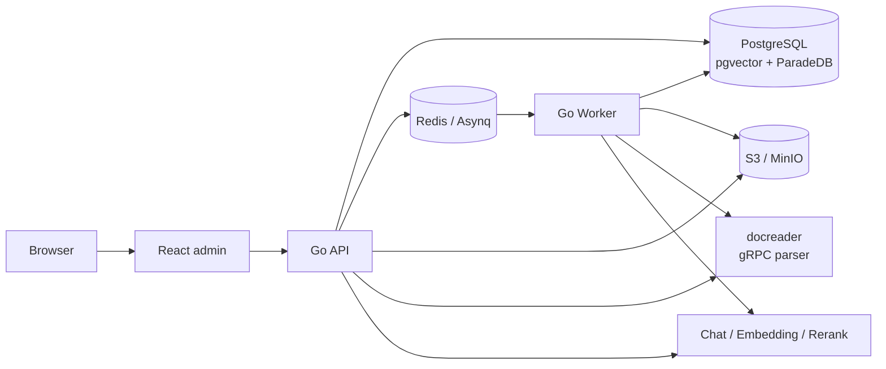

# RAG Platform

[](https://github.com/hzc19970630/rag-platform/actions/workflows/ci.yml)
[](https://github.com/hzc19970630/rag-platform/releases/latest)
[](LICENSE)
[](https://hzc19970630.github.io/rag-platform/)

[English](README.en.md) | [简体中文](README.md)

A self-hosted, multi-tenant RAG platform for internal knowledge bases. **Answers must carry evidence; permissions and upgrades must be auditable.**

Run it locally in one command (no model API key; deterministic local models):

```bash
git clone https://github.com/hzc19970630/rag-platform.git
cd rag-platform && cp .env.example .env && ./scripts/quickstart.sh
```

Open <http://localhost:5173>, create a knowledge base, upload `examples/demo/retrieval-handbook.md`, then ask:
“How does hybrid recall combine keyword and vector results?”. The answer carries citations, and the platform refuses when evidence is insufficient.

**Why this is not another RAG demo**

- **Evidence is a first-class citizen**: citation registration and validation, unauthorized-citation rejection, permission-negative tests, and refusal without evidence are all on the answer path.
- **Upgrades you can roll back**: per-knowledge-base vector-space migration (variant table + backfill + cutover/rollback), with a reproducible v0.1.0 → v0.2.0 upgrade drill.
- **Reviewable governance**: tenant/KB RBAC, API keys, audit, quotas, and optional PostgreSQL RLS (ENABLE + FORCE).
- **Zero-config without a fork**: preset packs are data; defaults are copied at creation, tenants can clone/edit their own packs, and built-in packs stay read-only.
- **Integrable**: stdio MCP with 8 scoped tools plus TypeScript/Python SDKs.

**New in v0.2.0**: retrieval quality loop (feedback, citation clicks, evaluation regression, and a high-risk save gate), preset packs and tenant-owned packs,
per-KB embedding migration with backfill, and configuration change preview. See [CHANGELOG](CHANGELOG.md) for the full list.

> Current release: [v0.2.0](https://github.com/hzc19970630/rag-platform/releases/tag/v0.2.0).
> Before production, read the [capability boundaries](#capability-boundaries) and [security policy](SECURITY.md): OCR, HA/Kubernetes, and multiple connectors are not supported yet.

[Quickstart](docs/quickstart.md) · [Docs](https://hzc19970630.github.io/rag-platform/) · [Release](https://github.com/hzc19970630/rag-platform/releases/latest) · [Comparison](docs/comparison.md)

## Architecture



The API owns authentication, authorization, knowledge bases, retrieval, answers, and SSE. The worker owns parsing, chunking, embedding, indexing, and projections. The parser runs in a restricted container, and raw files are read only through controlled interfaces. See [architecture](docs/architecture.md) for details.

## Quickstart

Prerequisites: Docker Engine/Desktop with Compose v2, and Git. The first build downloads images and dependencies and usually takes 5–15 minutes.

```bash
git clone https://github.com/hzc19970630/rag-platform.git
cd rag-platform
cp .env.example .env
./scripts/quickstart.sh
```

Open <http://localhost:5173>, click **Continue** on the development login panel, then:

1. Create a knowledge base.
2. Upload a Markdown/TXT/PDF document and wait for `EVIDENCE_READY`.
3. Open chat, ask about the document, and check the answer and citations.
4. Run the self-check to verify the whole chain:

```bash
./scripts/quickstart_check.sh
```

Stop the stack:

```bash
./scripts/quickstart.sh --down
```

The quickstart uses local deterministic models and the development identity, **for local evaluation only**. For production configuration, OIDC, real models, and object storage, see [quickstart](docs/quickstart.md) and the [operations manual](docs/operations.md).

## Capabilities

| Capability | Status | Notes |
| --- | --- | --- |
| Document ingestion | Available | PDF (digital text layer), DOCX, XLSX, PPTX, Markdown, TXT, HTML |
| Hybrid retrieval | Available | BM25 and vector recall in parallel, RRF fusion, optional rerank |
| Retrieval quality loop | Available | Helpful/unhelpful feedback, citation clicks, evaluation import and regression alerts; high-risk changes require a recent evaluation |
| Zero-config presets | Available | Built-in general enterprise pack; defaults copied at creation; tenants can clone/import/edit their own packs; built-in packs are read-only |
| Citations and refusal | Available | Citations resolve to chunks and document versions; unauthorized or unregistered citations are rejected |
| Multi-tenancy and RBAC | Available | Owner/Admin/Editor/Viewer, API keys, audit, tenant quotas |
| Document lifecycle | Available | Versions, re-parse, rollback, soft delete, retention cleanup |
| External data source | Available (single type) | `http_manifest` incremental sync, tombstones, SSRF protection, encrypted credentials |
| Wiki / relation projection | Available (optional) | Per-knowledge-base switch; projection failures do not block Evidence RAG |
| Async answers | Available | Worker generation, SSE resume, leases, terminal-state convergence |
| Vector-space migration | Available | Per-KB embedding model/dimension switch with rebuild → verify → cutover → rollback; the old space is kept until finalize |
| Browser E2E | Available | Playwright covers the main chain, admin console, accessibility, D3 migration entry, B14 quality feedback, and B23 presets |
| Observability | Available | Prometheus metrics, OTLP tracing, alert rules, Grafana dashboards |
| MCP / SDK | Available | stdio MCP (8 scoped tools) plus TypeScript/Python SDKs |
| OCR / images | Not supported | Scanned PDFs and mixed scanned pages return explicit errors; finance scans are prioritized on the roadmap |
| More connectors | Not supported | Finance sources (ECM/DMS, OA, email archives, domestic storage) and S3 first; SharePoint/Confluence/Feishu/WeCom later |
| Kubernetes/Helm | Not provided | Docker Compose is the only official deployment today |

## Release and verification

A `v*.*.*` tag triggers the release: full verification, image build and scan, CycloneDX SBOM, GHCR push, image digest and checksum signing, then a GitHub Release.

Download and verify release artifacts:

```bash
VERSION=v0.2.0
gh release download "$VERSION"
sha256sum -c SHA256SUMS

cosign verify-blob \
  --bundle SHA256SUMS.cosign.bundle \
  --certificate-identity "https://github.com/hzc19970630/rag-platform/.github/workflows/release.yml@refs/tags/${VERSION}" \
  --certificate-oidc-issuer "https://token.actions.githubusercontent.com" \
  SHA256SUMS
```

Image signatures, digests, SBOMs, and upgrade/rollback steps are in the [release manual](docs/releases.md). Every release ships `release-manifest.txt`, SBOMs for both images, and `SHA256SUMS`.

## Documentation

Online docs: <https://hzc19970630.github.io/rag-platform/> (built from `docs/` by `.github/workflows/docs.yml`).

| Document | Content |
| --- | --- |
| [Quickstart](docs/quickstart.md) | One-command start, first question, common commands |
| [Troubleshooting](docs/troubleshooting.md) | Ports, models, parsing, migrations, containers |
| [Testing](docs/testing.md) | Go/frontend unit tests, Playwright E2E, CI gates |
| [Architecture](docs/architecture.md) | Components, ingestion, retrieval, tenant isolation, deployment |
| [Operations](docs/operations.md) | Migrations, backups, drills, metrics, alerts |
| [Release manual](docs/releases.md) | Artifact verification, upgrades, rollback |
| [API](docs/api.md) | OpenAPI contract and how to browse it |
| [Comparison](docs/comparison.md) | Positioning against Dify/RAGFlow and others |
| [Roadmap](ROADMAP.md) | Public capability plan |
| [Contributing](CONTRIBUTING.md) | Development, tests, commits, DCO |
| [Security](SECURITY.md) | Vulnerability reporting, supported versions, hardening |

Most prose documentation is currently in Chinese; the API contract and comparison matrix are English-first.

## Development

```bash
# Go checks (Docker works when no host Go is installed)
make test
make lint

# Frontend
cd web
npm ci
npm run codegen:check
npm test
npm run build
```

Contracts come first: HTTP DTOs and route inventories live in `contracts/httpapi`; `go run ./cmd/openapi` generates OpenAPI, and the frontend uses `openapi-typescript`. Regenerate and commit generated artifacts after contract changes.

Dependency direction and tenant filtering are enforced by static gates:

```bash
go run ./cmd/checkdeps
go run ./cmd/checktenancy
go run ./cmd/openapi -check
```

## Capability boundaries

- Only PDFs with an extractable text layer are supported; scanned pages, images, and mixed scanned PDFs are not OCRed.
- A knowledge base has exactly one active embedding model and dimension at a time; switching uses migration + backfill + cutover/rollback. After `finalize`, old vectors are removed and only a backup can restore them.
- Rerank is off by default and must be enabled explicitly based on an evaluation set.
- Relation projection uses PostgreSQL relation tables; there is no separate graph database or graph visualization.
- The only external connector is `http_manifest`.
- Compose is the only official deployment today; HA, Kubernetes, and multi-region are not delivered.

See [architecture](docs/architecture.md) and the [roadmap](ROADMAP.md) for the full capability and limitation list.

## Security

Do not report vulnerabilities in public issues. Use GitHub's private vulnerability reporting; see [SECURITY.md](SECURITY.md). For production, at minimum disable the development identity, replace all placeholder credentials, enable OIDC, keep the data plane on a private network, and evaluate RLS enforce mode.

## License

This project is licensed under [MIT](LICENSE). Bundled third-party components keep their own licenses; before distribution, read [THIRD_PARTY_NOTICES](THIRD_PARTY_NOTICES.md) and the [license inventory](docs/licensing.md). ParadeDB, MinIO, and Redis licenses need separate review.
