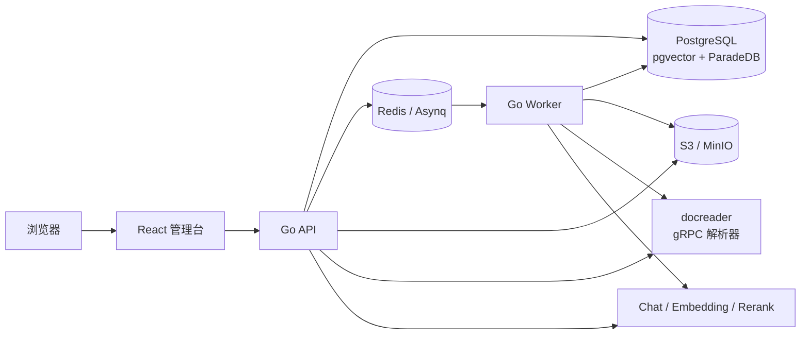

# RAG Platform

[](https://github.com/hzc19970630/rag-platform/actions/workflows/ci.yml)
[](https://github.com/hzc19970630/rag-platform/releases/latest)
[](LICENSE)
[](https://hzc19970630.github.io/rag-platform/)

面向企业内部知识库的多租户 RAG 平台：把数字文档加工成可治理、可检索、可追溯的证据，并输出带引用的答案。

- **有依据的回答**：混合检索（BM25 + 向量 + RRF）后生成，引用必须指向本次授权证据；证据不足时拒答。
- **企业治理**：租户/知识库 RBAC、API Key、审计、租户配额、可选的 PostgreSQL RLS 纵深防御。
- **可运营的入库**：解析、切分、向量化、索引全异步；状态机、幂等键、重试、死信、reconcile 与断线续传。
- **可演进的知识层**：Evidence RAG 之外，可选 LLM Wiki 投影与关系投影，按知识库独立启停。
- **可交付的发布**：语义化版本、扫描后的镜像、CycloneDX SBOM、cosign 无密钥签名、升级/回滚手册。

> 当前版本 [v0.1.0](https://github.com/hzc19970630/rag-platform/releases/tag/v0.1.0)。项目仍在快速演进，生产使用前请阅读[能力边界](#能力边界)与[安全策略](SECURITY.md)。

## 架构



API 负责认证、授权、知识库、检索、问答与 SSE；Worker 负责解析、切分、Embedding、索引和投影。解析器运行在受限容器中，原始文件只经受控接口读取。详细设计见[架构说明](docs/architecture.md)。

## 快速开始

前置条件：Docker Engine/Desktop（Compose v2）、Git。首次构建需要下载镜像和依赖，通常 5–15 分钟。

```bash
git clone https://github.com/hzc19970630/rag-platform.git
cd rag-platform
cp .env.example .env
./scripts/quickstart.sh
```

打开 <http://localhost:5173>，在登录页点击“继续（开发模式）”，然后：

1. 创建知识库。
2. 上传一个 Markdown/TXT/PDF 文档，等待状态变为 `EVIDENCE_READY`。
3. 进入问答，提问文档中的内容，检查答案与引用。
4. 运行自检脚本复核整条链路：

```bash
./scripts/quickstart_check.sh
```

停止服务：

```bash
./scripts/quickstart.sh --down
```

快速开始使用本地确定性模型和开发身份，**只用于本机体验**。生产配置、OIDC、真实模型和对象存储请见[快速开始](docs/quickstart.md)与[运维手册](docs/operations.md)。

## 能力

| 能力 | 状态 | 说明 |
| --- | --- | --- |
| 文档入库 | 可用 | PDF（数字文本层）、DOCX、XLSX、PPTX、Markdown、TXT、HTML |
| 混合检索 | 可用 | BM25 与向量并行召回，RRF 融合，可配置 Rerank |
| 引用与拒答 | 可用 | 引用回查 Chunk、文档版本；越权/未注册引用拒绝输出 |
| 多租户与 RBAC | 可用 | Owner/Admin/Editor/Viewer、API Key、审计、租户配额 |
| 文档生命周期 | 可用 | 版本、重新解析、回滚、软删除、保留期清理 |
| 外部数据源 | 可用（单类型） | `http_manifest` 增量同步、tombstone、SSRF 防护、凭据加密 |
| Wiki / 关系投影 | 可用（可选） | 按知识库开关；投影失败不阻断 Evidence RAG |
| 异步问答 | 可用 | Worker 生成、SSE 续传、租约与终态收敛 |
| 浏览器 E2E | 规划中 | 主链路自动回归与可访问性检查 |
| OCR / 图片 | 未支持 | 扫描 PDF、混合扫描页返回明确错误 |
| 更多连接器 | 未支持 | SharePoint/Confluence/飞书/企微/S3 等在路线图中 |
| Kubernetes/Helm | 未提供 | 当前交付方式为 Docker Compose |

## 发布与校验

发布由 `v*.*.*` tag 触发：先跑完整验证，再构建并扫描镜像，生成 CycloneDX SBOM，推送 GHCR，签名镜像 digest 与校验和，最后创建 GitHub Release。

从 Release 下载并校验产物：

```bash
VERSION=v0.1.0
gh release download "$VERSION"
sha256sum -c SHA256SUMS

cosign verify-blob \
  --bundle SHA256SUMS.cosign.bundle \
  --certificate-identity "https://github.com/hzc19970630/rag-platform/.github/workflows/release.yml@refs/tags/${VERSION}" \
  --certificate-oidc-issuer "https://token.actions.githubusercontent.com" \
  SHA256SUMS
```

镜像签名、digest、SBOM 与升级/回滚步骤见[发布手册](docs/releases.md)。每个 Release 都附带 `release-manifest.txt`、两个镜像的 SBOM 与 `SHA256SUMS`。

## 文档

在线文档站：<https://hzc19970630.github.io/rag-platform/>（由 `.github/workflows/docs.yml` 从 `docs/` 构建并发布）。

| 文档 | 内容 |
| --- | --- |
| [快速开始](docs/quickstart.md) | 一条命令启动、首个问答、常用命令 |
| [故障排查](docs/troubleshooting.md) | 端口、模型、解析、迁移、容器问题 |
| [测试](docs/testing.md) | Go/前端单测、Playwright E2E、CI 门禁 |
| [架构说明](docs/architecture.md) | 组件、入库、检索、租户隔离与部署 |
| [运维手册](docs/operations.md) | 迁移、备份、故障演练、指标与告警 |
| [发布手册](docs/releases.md) | 产物校验、升级、回滚 |
| [API 文档](docs/api.md) | OpenAPI 契约与在线查看方式 |
| [竞品对比](docs/comparison.md) | 与 Dify/RAGFlow 等项目的定位差异 |
| [路线图](ROADMAP.md) | 公开能力规划 |
| [贡献指南](CONTRIBUTING.md) | 开发、测试、提交与 DCO |
| [安全策略](SECURITY.md) | 漏洞报告、支持版本与加固清单 |

## 开发

```bash
# Go 检查（无宿主 Go 时可用 Docker）
make test
make lint

# 前端
cd web
npm ci
npm run codegen:check
npm test
npm run build
```

契约优先：HTTP DTO 与路由清单位于 `contracts/httpapi`，`go run ./cmd/openapi` 生成 OpenAPI，前端用 `openapi-typescript` 生成类型。修改契约后必须重新生成并提交产物。

依赖方向与租户过滤由静态门禁检查：

```bash
go run ./cmd/checkdeps
go run ./cmd/checktenancy
go run ./cmd/openapi -check
```

## 能力边界

- 仅支持含可提取文本层的 PDF；扫描件、图片和混合扫描 PDF 不做 OCR。
- 一个知识库绑定一个 Embedding 模型与维度；切换需要重建索引，尚未支持灰度。
- Rerank 默认关闭，需要基于评估集显式开启。
- 关系投影使用 PostgreSQL 关系表，不提供独立图数据库或图可视化。
- 外部连接器目前只有 `http_manifest`。
- Compose 是当前唯一官方部署方式；高可用、Kubernetes 和多区域尚未交付。

完整的能力与限制说明见[架构说明](docs/architecture.md)和[路线图](ROADMAP.md)。

## 安全

请勿在公开 issue 中报告安全漏洞。使用 GitHub 的私有漏洞报告流程，详见[安全策略](SECURITY.md)。生产部署至少应关闭开发身份、替换所有占位凭据、启用 OIDC、把数据面放在私网，并评估 RLS enforce 模式。

## 许可证

本项目使用 [MIT License](LICENSE)。随附的第三方组件保留各自许可证；分发前请阅读[第三方声明](THIRD_PARTY_NOTICES.md)与[许可证盘点](docs/licensing.md)，其中 ParadeDB、MinIO、Redis 的许可证需要单独评审。
