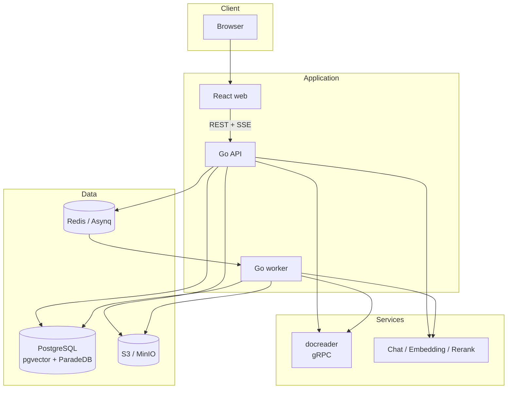
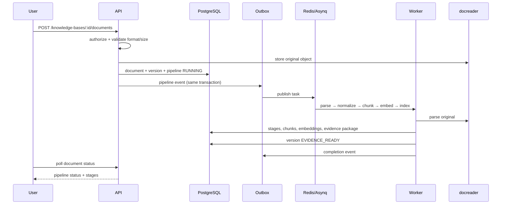
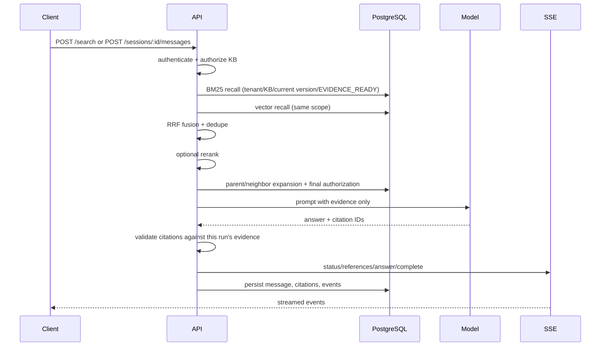
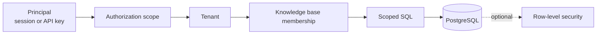

# Architecture

This document describes the runtime architecture, the ingestion and retrieval
paths, tenant isolation, and the reliability model. The longer design baseline is
in [DESIGN.md](https://github.com/hzc19970630/rag-platform/blob/main/DESIGN.md).

## Goals

- Turn digital documents into versioned, authorization-scoped evidence.
- Answer questions only from evidence the caller is allowed to read, with citations.
- Keep ingestion asynchronous and operable: retries, idempotency, dead letters, and
  reconciliation.
- Run as a modular monolith with a separately deployable parser and worker.
- Make tenant isolation explicit in the application and optionally enforce it in
  PostgreSQL.

## Non-goals

- OCR, image understanding, or arbitrary agent code execution.
- A plugin for every storage or model vendor.
- Kubernetes/Helm delivery in the current release.
- Treating Wiki or graph projections as required for basic evidence RAG.

## Components

| Process | Responsibility | Scaling unit |
| --- | --- | --- |
| `web` | React SPA: knowledge bases, documents, chat, administration, operations | Static/CDN in production |
| `api` | Authentication, authorization, knowledge-base APIs, search, chat/SSE, operations | Stateless replicas |
| `worker` | Parse orchestration, chunking, embedding, indexing, projections, cleanup | Per queue |
| `docreader` | Restricted document parsing over gRPC | Per parse workload |
| PostgreSQL | Metadata, evidence, vectors, BM25, projections, audit, outbox/inbox | Vertical first; replicas/partitioning later |
| Redis/Asynq | Task queues, rate limiting, cache invalidation | Managed Redis |
| S3/MinIO | Original files and normalized artifacts | Versioned object storage |

## Ingestion path

Key properties:

- The upload response is a pipeline handle, not a promise that parsing finished.
  Clients poll the document status or watch the document list.
- The outbox row is written in the same transaction as the state change. A crash
  after commit still results in publication.
- Tasks are idempotent: re-delivery does not create duplicate chunks or evidence.
- Only the current version in `EVIDENCE_READY` is searchable. Replacing a document
  retires the previous version from retrieval.
- A failed stage records a stable error code and can be retried from operations
  endpoints or the UI.

## Retrieval and answer path

- BM25 and vector recall run in parallel and are merged with reciprocal rank fusion.
- Every query carries tenant, knowledge-base, current-version, and
  `EVIDENCE_READY` predicates. A second authorization pass runs before delivery.
- Citations are first-class data. The model can only cite registered evidence IDs;
  unresolvable or unauthorized citations are rejected.
- Insufficient evidence produces a refusal with `insufficient_evidence`, not a
  general-knowledge answer.
- Async answers persist events before streaming them. Clients can resume from
  `after`/`Last-Event-ID`; a worker restart produces a terminal event instead of a
  stream that never ends.

## Tenant isolation

Defense in depth:

1. Authentication establishes a principal and tenant.
2. Every knowledge-base operation resolves membership and action.
3. SQL queries inject `tenant_id` and knowledge-base scope; static checks reject new
   unscoped GORM paths.
4. Retrieval re-checks that chunks belong to the current version and the caller's
   authorized evidence set.
5. `TENANT_RLS_MODE=enforce` adds PostgreSQL row-level security with separate runtime
   roles for defense in depth. Production startup rejects `shadow`/`off` when
   `APP_ENV=production`.

## Reliability primitives

| Primitive | Purpose |
| --- | --- |
| Outbox | Publish tasks/events in the same transaction as state changes |
| Inbox/lease | Deduplicate and serialize task claims across workers |
| Idempotency key | Prevent duplicate uploads and repeated answer generation |
| Stage state machine | Track parse/normalize/chunk/embed/index progress and failures |
| Dead letters | Preserve failed tasks for inspection and replay |
| Reconcile | Repair expired leases and interrupted pipelines |
| Retention/cleanup | Purge soft-deleted documents and expired task history |

Wiki and relation projections are optional. They reuse the evidence pipeline and
authorization ports, run on a separate queue, and never block evidence RAG when they
fail. See [DESIGN.md](https://github.com/hzc19970630/rag-platform/blob/main/DESIGN.md) for the projection join semantics.

## Deployment

The supported deployment is Docker Compose:

- `deploy/docker-compose/docker-compose.yml`: local development stack.
- `deploy/docker-compose/quickstart.compose.yml`: local-only overlay with
  development identity and deterministic models.
- `deploy/docker-compose/release.compose.yml`: pinned release images for api and
  docreader; the web UI is a static bundle.

Release images are scanned, published with CycloneDX SBOMs, and signed with cosign.
Upgrade order is migrate → docreader → worker → api. See
[Releases](releases.md) and [Operations](operations.md).

## Capability boundaries

- Digital PDFs only; no OCR for scanned or mixed PDFs.
- One embedding model/dimension per knowledge base; changing it requires a managed
  re-index.
- Rerank is opt-in and off by default.
- Only the `http_manifest` connector is implemented.
- Kafka, OpenSearch, Neo4j, and Kubernetes are not part of the current runtime.

These boundaries are intentional: the platform prefers a small, testable core over
feature-count parity.
