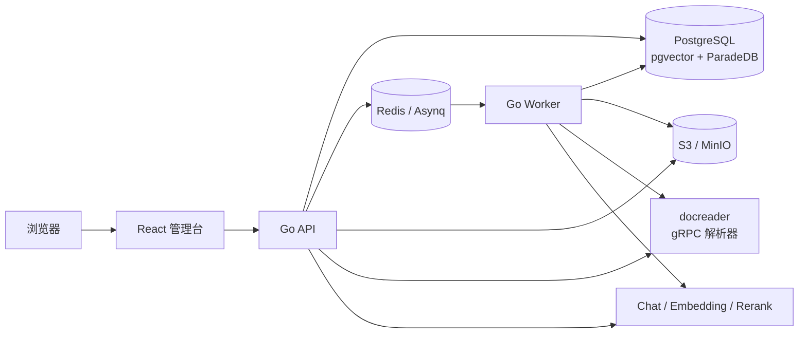

# RAG Platform

面向企业内部知识库的多租户 RAG 平台：把数字文档加工成可治理、可检索、可追溯的证据，并输出带引用的答案。

当前版本：[v0.1.0](https://github.com/hzc19970630/rag-platform/releases/tag/v0.1.0)

## 核心能力

- **证据驱动**：BM25 + 向量混合召回，RRF 融合，引用必须指向本次授权证据；证据不足时拒答。
- **企业治理**：租户/知识库 RBAC、API Key、审计、配额、可选的 PostgreSQL RLS。
- **可运营入库**：异步流水线、状态机、幂等、重试、死信、reconcile、SSE 断线续传。
- **可扩展知识层**：可选的 Wiki 投影与关系投影，按知识库独立启停。
- **可交付发布**：扫描后的镜像、CycloneDX SBOM、cosign 签名、升级/回滚手册。

## 架构概览

详细说明见[架构](architecture.md)。

## 快速入口

| 目标 | 文档 |
| --- | --- |
| 本机启动并完成首个问答 | [快速开始](quickstart.md) |
| 启动失败或结果异常 | [故障排查](troubleshooting.md) |
| 理解入库与检索链路 | [架构](architecture.md) |
| 备份、升级、故障演练 | [运维](operations.md) |
| 校验 Release、升级与回滚 | [发布与回滚](releases.md) |
| 查看 HTTP 契约 | [API](api.md) |
| 与 Dify/RAGFlow 等对比 | [竞品对比](comparison.md) |
| 录制演示 | [Demo](demo.md) |

## 能力边界

- 仅支持含可提取文本层的 PDF；扫描件、图片和混合扫描 PDF 不做 OCR。
- 一个知识库绑定一个 Embedding 模型与维度；切换需要受管重建索引。
- Rerank 默认关闭，需要基于评估集显式开启。
- 外部连接器目前只有 `http_manifest`。
- Compose 是当前唯一官方部署方式；Kubernetes/Helm 尚未交付。

## 参与

- [贡献指南](contributing.md)
- [安全策略](security.md)
- [公开路线图](https://github.com/hzc19970630/rag-platform/blob/main/ROADMAP.md)
- [GitHub Issues](https://github.com/hzc19970630/rag-platform/issues)
